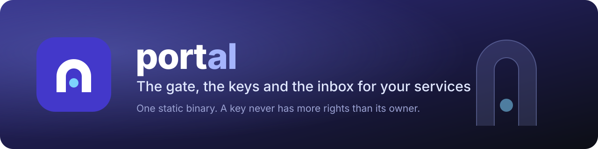
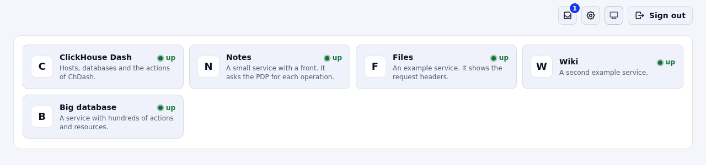
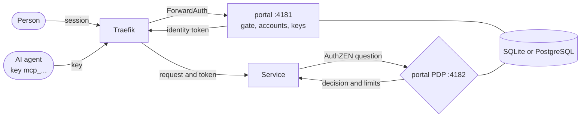
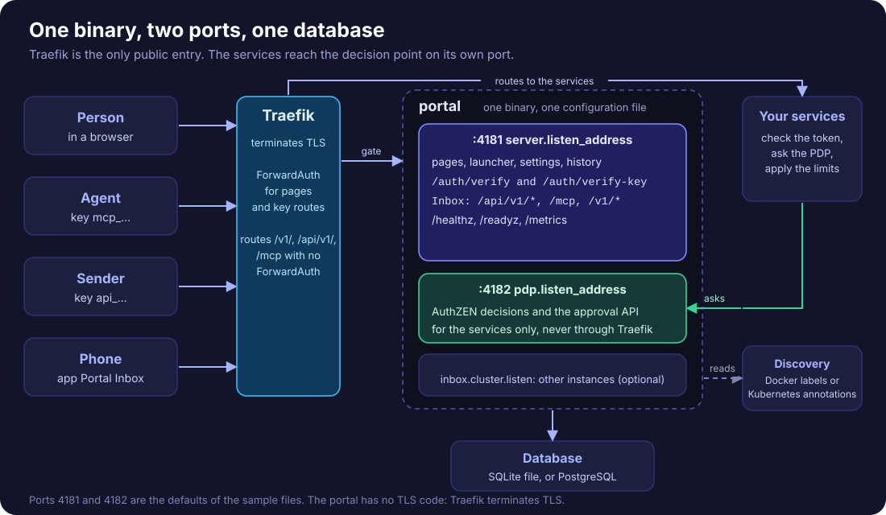
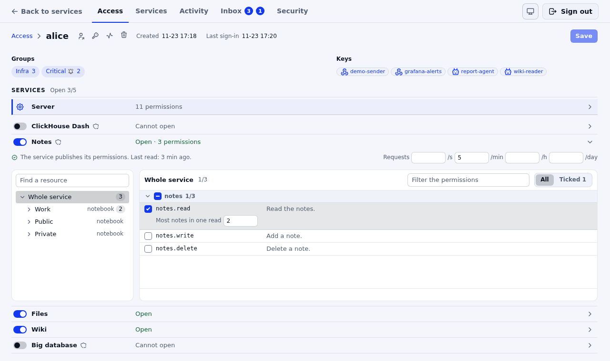
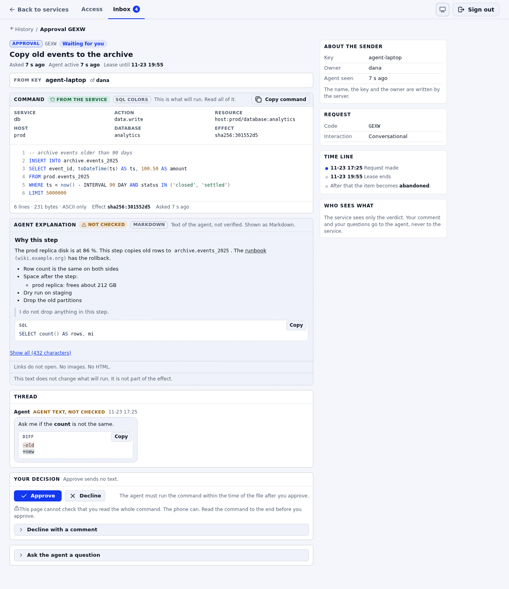

<p align="center">
  
</p>

<p align="center">
  <a href="https://github.com/ProcurAuth/portal/actions/workflows/ci.yml"></a>
  <a href="https://github.com/ProcurAuth/portal/actions/workflows/nightly.yml"></a>
  <a href="https://github.com/ProcurAuth/portal/releases/latest"></a>
  <a href="#licence"></a>
  <a href="https://procurauth.github.io/procurauth/implementations.html"></a>
  
  
  
</p>

<p align="center">
  <a href="https://procurauth.github.io/portal/"><b>Website</b></a> ·
  <a href="https://procurauth.github.io/portal/documentation.html">Documentation</a> ·
  <a href="https://procurauth.github.io/portal/configuration.html">Configuration</a> ·
  <a href="https://procurauth.github.io/portal/security.html">Security</a> ·
  <a href="https://github.com/ProcurAuth/portal/releases/latest">Downloads</a>
</p>

# portal

portal is one program for the web services of a lab. It opens sessions for people and guards each service. It gives keys to AI agents, answers AuthZEN questions and sends alerts to Android phones.

It is for people who run their own services behind Traefik and want one account system, one gate and one inbox. **A key never has more rights than the person who owns it.** A service does not manage users or keys. It gets a short identity token and asks portal what the key may do.

portal is the backend, the edge and the decision point of [ProcurAuth](https://github.com/ProcurAuth/procurauth). It has one binary, one configuration file and one database (SQLite, or PostgreSQL for several instances).

<p align="center">
  <picture>
    <source media="(prefers-color-scheme: dark)" srcset="docs/assets/screenshots/launcher-dark.png">
    
  </picture>
</p>

## How it works

Traefik asks portal about each request. portal answers from memory with the grants of the person. For an agent, portal checks the key and gives the service an identity token. The service asks the decision point one AuthZEN question and applies the limits in the answer.



<p align="center">
  
</p>

| Part | What it gives |
|---|---|
| **Launcher** | A page of tiles for the services of the lab. A service lists itself with a label (Docker Compose) or an annotation (Kubernetes). |
| **Gate** | A Traefik ForwardAuth server. A grant is an action on a node of the resource tree of a service. A new user has no grant. |
| **Accounts** | Argon2id passwords, opaque sessions bound to the client, a second factor (TOTP), and a log of sign-ins. |
| **Keys and limits** | `mcp_` keys for agents and `api_` keys for senders. A key follows its owner. Ceilings and budgets limit it. |
| **Decision point** | An AuthZEN PDP on its own port. It signs identity tokens and counts budgets. |
| **Approvals** | A grant can ask a person before each use by a key. The person answers on a phone or on a web page. |
| **Inbox** | Alerts, questions and approvals for the Android app Portal Inbox, on a Noise session. Each phone shows each alert one time. |
| **Configuration** | One strict HCL file. An unknown key stops the program. A secret comes only from `_env` or `_file`. |

## Example

Alice has the grant `query.run.read` on the host `local` of the service `db`. Her agent has a key with a ceiling `max_rows` of 100. The service `db` asks one question:

```json
{ "subject":  { "type": "user", "id": "key:9b1c5d0e" },
  "action":   { "name": "query.run.read" },
  "resource": { "type": "database", "id": "analytics",
                "properties": { "ancestors": [ { "type": "service", "id": "db" },
                                               { "type": "host", "id": "local" } ] } },
  "context":  { "usage": { "units": 1 } } }
```

portal answers that the key may read, with the ceiling and the count of the budget:

```json
{ "decision": true, "context": { "limits": { "max_rows": 100 }, "usage": { "units": 1 } } }
```

When the budget is spent, the answer is `{ "decision": false, "context": { "reason": "budget_exceeded", "retry_after": 12 } }`. The grant on the host covers the database below it. The key holds only what its owner holds.

## See it

<p align="center">
  <picture>
    <source media="(prefers-color-scheme: dark)" srcset="docs/assets/screenshots/settings-grants-dark.png">
    
  </picture>
</p>

<p align="center">
  <picture>
    <source media="(prefers-color-scheme: dark)" srcset="docs/assets/screenshots/approval-dark.png">
    
  </picture>
</p>

## Quick start

This section gives two paths: the release binary and the Compose stack.

### The release binary

This path takes five minutes on Linux (amd64 or arm64). Docker is not necessary. You need `curl`, `sha256sum`, `tar` and `openssl`.

These commands download portal and check the archive. For arm64, use the archive `portal_5.6.0_linux_arm64.tar.gz`. The archive holds one static file, `portal`.

```sh
curl -fsSLO https://github.com/ProcurAuth/portal/releases/download/v5.6.0/portal_5.6.0_linux_amd64.tar.gz
curl -fsSLO https://github.com/ProcurAuth/portal/releases/download/v5.6.0/SHA256SUMS
sha256sum -c --ignore-missing SHA256SUMS
tar -xzf portal_5.6.0_linux_amd64.tar.gz
./portal version
```

Make the secret files. The first two files hold the login and the password of the superadmin. The third file holds the key that encrypts the secrets of the second factor.

```sh
mkdir -p secrets data
echo admin > secrets/superadmin_login
openssl rand -base64 24 > secrets/superadmin_password
openssl rand -hex 32 > secrets/totp_key
chmod 600 secrets/*
```

These commands write the configuration, check it and start portal. A path in the file must be absolute. The shell replaces `$PWD` with the current directory.

```sh
cat > config.hcl <<EOF
server {
  listen_address  = "127.0.0.1:4181"
  trusted_proxies = []
}

authentication {
  superadmin_login_file    = "$PWD/secrets/superadmin_login"
  superadmin_password_file = "$PWD/secrets/superadmin_password"
  totp_key_file            = "$PWD/secrets/totp_key"
}

storage {
  database = "$PWD/data/portal.db"
}
EOF
./portal check-config --config config.hcl
./portal run --config config.hcl
```

`check-config` prints the value of each key and its source: `file`, `default`, or `file:` and the path of a secret file. It shows `<hidden>` in place of the values of the secret files. Its last line is `configuration ok`.

Open <http://127.0.0.1:4181/auth/login>. Use the login `admin` and the password in `secrets/superadmin_password`. Press Ctrl+C to stop portal.

The file has no `keys`, `pdp` or `inbox` block, and it trusts no proxy. With SQLite, the sessions stay in the memory of the process, so a restart ends them. [Configuration](docs/configuration.md) gives each block and each default.

### The Compose stack

The stack has portal with the inbox, and PostgreSQL. You need `git` and Docker. The image stays on your machine.

```sh
git clone https://github.com/ProcurAuth/portal && cd portal
tools/build.sh image                  # builds the image on this machine
deploy/compose/init-secrets.sh        # makes the secret files
docker compose up -d                  # starts portal and PostgreSQL on 127.0.0.1:4181
```

Open <http://127.0.0.1:4181/auth/login>. Use the login and the password from the files `superadmin_login` and `superadmin_password` in `deploy/compose/secrets/`. The command `docker compose down -v` stops the stack and deletes its data.

For a stack with Traefik, example services, three users and grants, run `./demo/up.sh`. See [Getting started](docs/getting-started.md).

## The ProcurAuth family

portal is a program of the [ProcurAuth](https://github.com/ProcurAuth) organisation. The organisation holds the open specification and the programs that follow it. The [implementations page](https://procurauth.github.io/procurauth/implementations.html) lists them, with the results of the conformance runs.

<p align="center">
  
</p>

| Part | Role | Repository | Site |
| --- | --- | --- | --- |
| **procurauth** | The specification and the reference tools | [ProcurAuth/procurauth](https://github.com/ProcurAuth/procurauth) | [procurauth.github.io/procurauth](https://procurauth.github.io/procurauth/) |
| **portal** | Backend, edge and PDP | [ProcurAuth/portal](https://github.com/ProcurAuth/portal) | [procurauth.github.io/portal](https://procurauth.github.io/portal/) |
| **Stowr** | PEP: a browser for S3, Google Cloud Storage and folders | [ProcurAuth/stowr](https://github.com/ProcurAuth/stowr) | [procurauth.github.io/stowr](https://procurauth.github.io/stowr/) |
| **Hune** | PEP: dashboards over ClickHouse, PostgreSQL and MongoDB | [ProcurAuth/hune](https://github.com/ProcurAuth/hune) | No public site yet |
| **ClickHouse Dash** | PEP and MCP server: a query console for ClickHouse | Outside this organisation | [Implementations page](https://procurauth.github.io/procurauth/implementations.html#programs) |

To add a program to this list, open an issue in the [specification repository](https://github.com/ProcurAuth/procurauth/issues).

## Documentation

The [site](https://procurauth.github.io/portal/) and the `docs/` folder have the same pages. The Markdown files are the source.

| Page | Content |
|---|---|
| [Overview](docs/overview.md) | What portal is and how it is built |
| [Getting started](docs/getting-started.md) | Compose stack, demo, first service |
| [Architecture](docs/architecture.md) | Listeners, flows, layout of the repository |
| [Authentication and sessions](docs/authentication.md) | Accounts, sessions, second factor |
| [Grants and the gate](docs/grants-and-gate.md) | The resource tree, grants, the decision of the gate |
| [Identity tokens and the PDP](docs/identity-and-pdp.md) | Tokens, AuthZEN endpoints, approvals |
| [Keys and limits](docs/keys-and-limits.md) | Key kinds, ceilings, budgets |
| [Launcher and service discovery](docs/launcher.md) | Labels, annotations, health |
| [Settings pages and history](docs/settings-and-history.md) | Users, grants, keys, activity |
| [Several instances](docs/several-instances.md) | PostgreSQL and high availability |
| [Traefik and TLS](docs/traefik.md) | The duties of the proxy |
| [Inbox](docs/inbox/README.md) | Alerts, agents, approvals, the Android app |
| [Configuration](docs/configuration.md) | Every key, generated from the code |
| [Security model](docs/security.md) | Trust, invariants, hardening |
| [Operations](docs/operations.md) | Metrics, backups, upgrades |
| [Build and release](docs/build-and-release.md) | Build, test, release |
| [Reference](docs/reference.md) | HTTP endpoints and error codes |
| [Limitations](docs/limitations.md) | Known limits |
| [Changelog](CHANGELOG.md) | History of the versions |

## Build and test

Use Docker. Do not install Rust on your machine.

```sh
tools/dev/lint.sh     # format and clippy
tools/dev/test.sh     # the tests, with a throwaway PostgreSQL
```

## Security

Report a vulnerability in private: <https://github.com/ProcurAuth/portal/security/advisories/new>. Do not open a public issue. Read [SECURITY.md](SECURITY.md) for the scope and the response times, and [Security model](docs/security.md) for the model.

## Contribute

Read [CONTRIBUTING.md](CONTRIBUTING.md) and the [code of conduct](CODE_OF_CONDUCT.md). The tests and the checks run in Docker with `tools/dev/lint.sh` and `tools/dev/test.sh`.

## Licence

portal is licensed under either of [MIT](LICENSE-MIT) or [Apache-2.0](LICENSE-APACHE), at your option.
