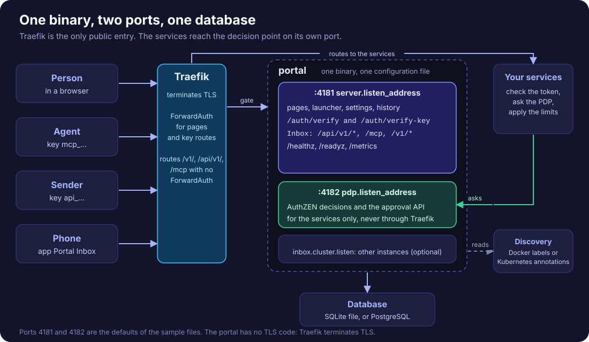
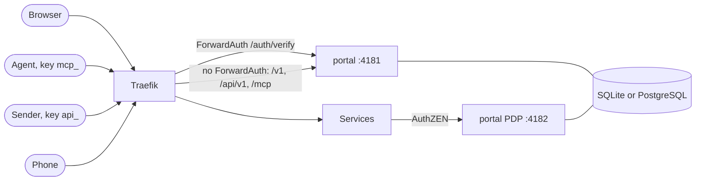
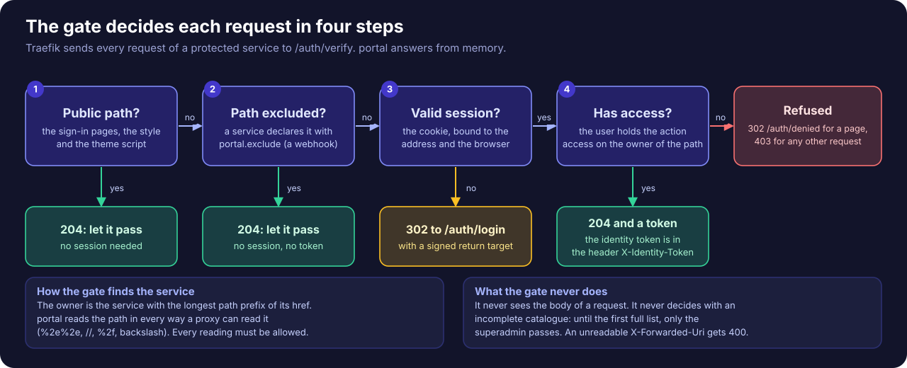
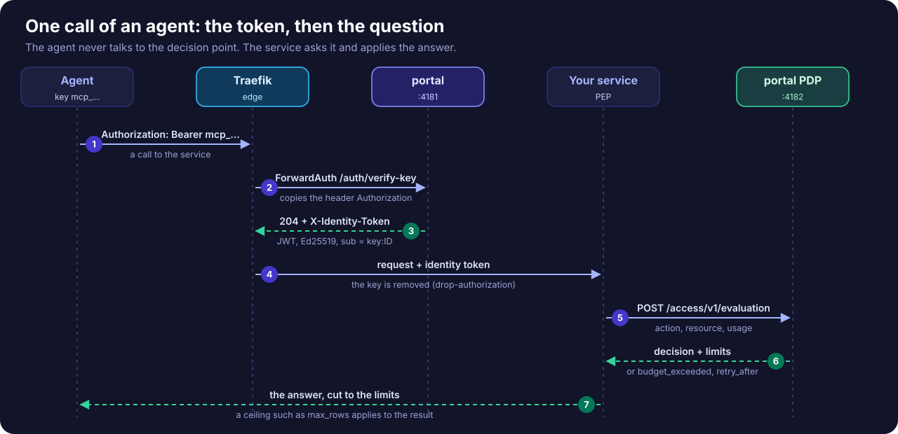
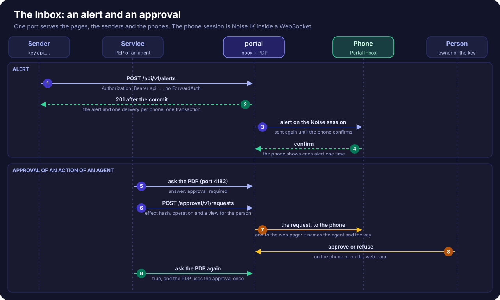

# Architecture

This page shows the parts of portal, its three listeners, the path of a request, and the layout of the repository. Read it to know which port to expose, which port to hide, and where each function lives.

## The listeners

portal has up to three listeners. Each listener has its own key in the configuration file.

| Listener | Key | Use | Who reaches it |
|---|---|---|---|
| Portal | `server.listen_address` | The pages of the portal, the settings, `/auth/verify`, `/auth/verify-key`, `/healthz` and `/metrics`. With the block `inbox`, also the Inbox: the API for the senders and the webhooks (`/api/v1/*`, `/api/version`), the routes of the phones (`/v1/enroll`, `/v1/session`), the MCP endpoint of the agents (`/mcp`) and `/readyz`. | Traefik and Prometheus. Traefik sends `/v1/`, `/api/v1/`, `/mcp` and `/api/version` to it without ForwardAuth. |
| PDP | `pdp.listen_address` | The AuthZEN decisions and the approval API. Optional. | The services only. Do not route it through Traefik. |
| Cluster | `inbox.cluster.listen` | Copies of alerts between instances. Optional. | The instances of the same cluster only. |

The Inbox is a feature of the portal. The pages, the senders, the webhooks and the phones use one port. The two routes of the phones are HTTP upgrade requests. The content is Noise-encrypted inside WebSocket frames. A reverse proxy carries them with path routing, so a separate exposure, connection budget and retry need no second port. The metrics of the portal and of the Inbox are in one Prometheus text at `metrics.path` of the portal listener.

portal has no TLS code on any listener. Traefik terminates TLS. portal reads the scheme of each request from `X-Forwarded-Proto`. See [Traefik and TLS](traefik.md).

## The path of a request

### A person opens a service

Traefik sends each request of a protected service to `/auth/verify` first. portal answers from memory. The answer is status 204, a redirect to the sign-in page, or a refusal. With an identity block, a 204 answer carries an identity token.

The rules of the gate are on the page [Grants and the gate](grants-and-gate.md).

### An agent calls a service with a key

An agent has no session. It sends its key. A second ForwardAuth address, `/auth/verify-key`, checks the key. The service then asks the decision point, and it applies the limits in the answer.

See [Keys and limits](keys-and-limits.md) and [Identity tokens and the PDP](identity-and-pdp.md).

### An alert or an approval reaches a phone

A sender posts an alert with an `api_` key. portal stores it and sends it on the Noise session of each subscribed phone. An approval of an agent action takes the same path to the phone, and the person can also answer on a web page.

See [Inbox](inbox/README.md).

## The processes and the data

- portal runs as one process, with one Tokio runtime. The Inbox runs in the same process.
- The state is in one database. The default is one SQLite file with one active instance. PostgreSQL lets several instances run at once. See [Several instances](several-instances.md).
- A restart with SQLite ends all sessions, because they live in memory. With PostgreSQL, sessions live in the database and survive a restart.
- The instance opens its ports only when the directory, the catalogue and the first read of the documents of the services are ready. See [Operations](operations.md).
- The Android app is a client of the Inbox. It holds one encrypted connection to the portal for each server. It does not use a push service of a third party.

## Layout of the repository

| Path | Content |
|---|---|
| `src/` | The binary `portal`. The code of the Inbox is in `src/inbox/`. |
| `crates/inbox-core` | The protocol and the cryptography of the phones, with no I/O. The server and the app share it. |
| `crates/inbox-android`, `android/` | The JNI bridge and the Android app (name Portal Inbox, application id `app.portalinbox`). |
| `web/` | The style sheets, the icons and the scripts of the pages. |
| `deploy/`, `docker-compose.yml`, `docker/` | The Compose stack, the K3s manifests and the Dockerfile. |
| `demo/` | A local demo with Traefik and example services. |
| `tools/` | The scripts for the build, the tests, the emulator, the documentation and the release. |
| `docs/` | The documentation: the Markdown sources and the static site that comes from them. |
| `examples/` | Examples of Traefik and Prometheus files. |
| `assets/brand/` | The logo files. |

These are the main modules of the binary:

- `src/http`: the listeners, the routes, the gate, the PDP and the approval API.
- `src/config`: the strict reader of the configuration and the table of keys.
- `src/store`: SQLite and PostgreSQL.
- `src/catalog` and `src/discovery`: the launcher and the sources of services.
- `src/ui`: the pages.
- `src/inbox`: alerts, phones, items and agents.
