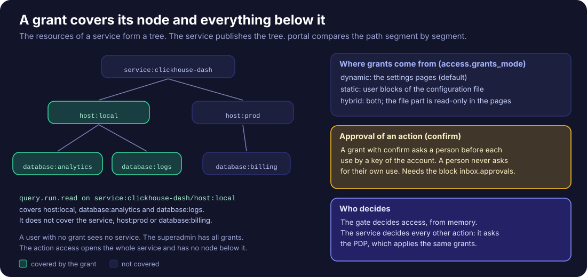
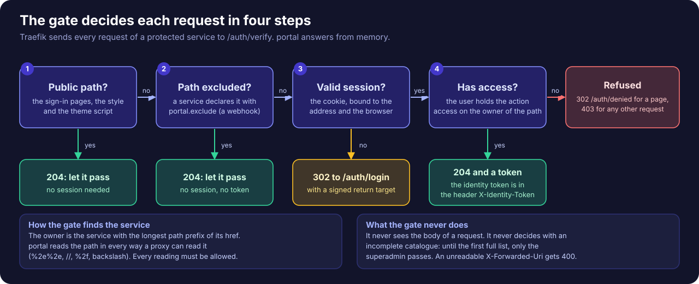

# Grants and the gate

A grant lets a user or a key do one action on one node of a service. The gate checks the grant `access` on each request that Traefik sends to portal. This page gives the form of a grant and the sources of the grants. It also gives the approval flag `confirm`, the decision of the gate and the paths that need no session.

The settings pages say "permission" where this page and the [ProcurAuth protocol](https://procurauth.github.io/procurauth/specification.html) say "grant". The two words name the same thing.

## Grants

A grant is an action on a node of the resource tree of a service (protocol sections 4 and 5). A grant has this form:

```text
<action> on service:<id>[/<type>:<resource id>]...
```

- `access on service:grafana`: the grant applies to the whole service.
- `query.run.read on service:clickhouse-dash/host:local`: the grant applies to the host `local` and to each node below it.
- `query.run.write on service:clickhouse-dash/host:local/database:analytics`: the grant applies to the database `analytics` of the host `local`.



The picture shows one service with a tree of hosts and databases. A grant on a node covers this node and each node below it. A grant on a database does not cover its host, a database of another host, or the whole service. A key has its own grants. The key never goes beyond the grants of its owner.

### The parts of a grant

- The `<action>` is a lower-case name. It has parts of `a-z`, `0-9` and `_`, joined by `.`. It has 64 characters at most.
- The `<id>` is the id of the service in the catalogue. It has lower-case letters and digits, joined by `-`, and 64 characters at most. The id is the label `portal.id`, or the slug of the group and the name. The id `portal` is reserved (see "Approval of an action").
- The part after the service has 0 to 4 segments. Each segment is `<type>:<resource id>`.
- A type starts with `a-z`. Then it has `a-z`, `0-9` and `_`. It has 1 to 32 characters. The type `service` is the whole service: it is never a segment.
- Each resource id is percent-encoded (RFC 3986). Each byte outside `A-Z a-z 0-9 - . _ ~` is `%XX`, with upper-case hex digits. For example, the id `a/b` is `a%2Fb`. A `/` or a `:` in an id never divides a segment.
- The escape form is canonical. portal refuses another escape form of the same id, for example `%2f` or `%61`.
- A decoded id has 1 to 256 bytes, with no control character. portal uses the id as it is and never changes its case. The settings pages show the decoded ids.
- A grant can hold limit values. See [Keys and limits](keys-and-limits.md#rights-limits-and-commands).
- A grant can have the property `confirm` (see "Approval of an action"). It is not a limit: it has no value and no counter. The text form of the grant does not show it.

### What each action means

- `access` lets the user open the service. portal decides `access` in `/auth/verify`. `access` has no grant below the service: it opens the whole service.
- The service `portal` is the scope of the functions of portal itself. It is not a service of the protocol (see "Approval of an action").
- The other actions are the actions that the service publishes at `/.well-known/procurauth/actions` (protocol 5.1). The service decides these actions. The service asks the PDP of portal. See [Identity tokens and the PDP](identity-and-pdp.md#actions-of-the-services).

### Coverage and the resource tree

- A grant covers the node that it names and each node below it. portal compares the segments one by one (prefix match). For example, `query.run.read on service:db` covers each host and each database of `db`.
- A grant below the service does not cover its parent, a node of another branch, or the whole service.
- The service gives its tree of resource types. The top-level list `resource_types` of its document declares each type and its parent. The parent is `service` or another declared type. The list is mandatory (protocol 5.2). It can be empty: each action of the document then lists only the type `service`.
- A document without the list is bad as a whole. portal keeps the last good document.
- Each action of the document has a list `resource_types`. It names the types on which a grant for this action is valid.
- The types of the segments must follow the parents. With `host` below `service` and `database` below `host`, write `host:<id>/database:<id>`. A grant on `database:<id>` alone does not follow the tree.
- A grant below the service applies only when the last known document of the service follows it. The action must list the type of the last segment. The segments must follow the parents. Otherwise the PDP does not apply the grant.
- When portal never read the document of the service, the PDP applies no grant below this service. A grant on the whole service needs no declaration.
- Two grants that differ only by `confirm` count as one grant with `confirm`, when their limit values are equal.

### Who has grants

- A new user has no grant. The user sees no service until the superadmin gives a grant.
- The superadmin has all grants. The superadmin has no `user` block in the file.
- portal has no groups of users. Each user has their own grants.
- A key has its own grants. The PDP also looks at the grants of the owner of the key (see [Keys and limits](keys-and-limits.md)).

## Where the grants come from

The key `access.grants_mode` gives the source of the grants. The three modes are the three sources of protocol 3.5.

| Mode | Grants of the `user` blocks | Grants of the settings pages |
|---|---|---|
| `static` | The server uses them. | The server does not use them. The settings pages show the grants and do not change them. If the database holds grants, the server writes the warning `stored_grants_not_used` at start. |
| `dynamic` (default) | A `user` block stops the server at start. | The superadmin gives and removes them. The database keeps them. |
| `hybrid` | The server uses them. They are read-only in the settings pages. | The superadmin gives and removes them. |

```hcl
access {
  grants_mode = "hybrid"
}

user "alice" {
  grants = ["access on service:grafana", "query.run.read on service:db"]
}
```

The server reads the `user` blocks at each start. When you remove a grant from the file, the grant stops at the next start. The server does not write the grants of the file to the database.

A `user` block can give a grant below the service, for example `"query.run.write on service:db/host:local/database:analytics"`. A grant with a bad form stops the start. Examples are a bad type, a bad escape and more than 4 segments.

At start, portal does not know the services yet: the catalogue and the action documents come at run time. A grant that does not follow the tree of its service therefore does not stop the start. The Services settings page lists it under "permissions to check". The log has the warning `grant_to_check`. At run time, the PDP does not apply this grant.

## Approval of an action

A grant can ask for the approval of a person before each use of its action. The grant then has the property `confirm`. The PDP uses the property: see [The approval gate](identity-and-pdp.md#the-approval-gate).

- Each action of each service can ask, except `access` and `mcp.session`. A service must handle `approval_required` for all its actions. A service that cannot approve one of its actions does not conform (protocol 1.3 and 17). The document of the service has no member for this. The file of portal has no flag for it. portal ignores a member `approval` in an action.
- The PDP asks for an approval only when the file has the block `inbox.approvals`. Otherwise the PDP gives a plain `false`, and the approval API gives `403`.
- In the grant editor, a lock button shows on the row of each ticked permission of a service, when the file has the block `inbox.approvals`. An open lock means no approval. A closed lock means that the permission asks for an approval.
- Without the block `inbox.approvals`, the editor offers no lock. A grant that already has `confirm` shows a closed lock that is off. The tooltip tells the reason.
- The action `access`, the action `mcp.session` and the actions of the service `portal` have no lock.
- The tooltip of the lock on the form of an account says that the lock asks for the keys of the account. The account itself never asks.
- The tooltip also says that a call that cannot wait gets `approval_cannot_wait`. A page of the service is such a call.

### The scope `portal` is not a service

The service `portal` holds the functions of portal itself: the keys, the alerts and the questions of the Inbox. The settings pages call it "Server permissions".

- Its document is in the code of portal. It has no PEP, no route `/.well-known/procurauth/actions` and no identity token.
- portal decides these actions in process.
- Protocol 1.3a lets a PDP have such built-in actions. Protocol 1.3, 5.2b and 17 do not apply to them, so `confirm` is refused on them.
- The server refuses `confirm` on a grant of the service `portal`, on the action `access` and on the action `mcp.session`. A form that asks for it gets a bad grant. A file that asks for it stops at start.
- The action `mcp.session` opens a session and answers the methods that have no tool, for example `initialize` and `ping`. It has no effect to approve, and such a method cannot wait (protocol 17.8, binding 3.6a). A tool of a service never uses it.

### A person never asks for their own use

The `confirm` of a grant of a person has no effect on the questions of that person (protocol 17.8). The person would approve their own action. The flag applies to the keys of the person.

- The decision for a key asks when a grant of the key has `confirm`. It also asks when a grant of the owner has `confirm`.
- The two sides combine with OR, as the limits do. When the owner is the superadmin, only the grants of the key count.
- The approval API never gets a person as the subject of a request.
- A key shows the chip `confirm` in the list of the keys. The editor of a key shows the lock closed and locked when a grant of the owner asks for the approval. The person cannot open it, because the key cannot go beyond its owner.

### An operation with several permissions

The approval follows the action of the use alone (protocol 5.5a and 17.7). The action of the use is the action that the call runs.

- For example, the tool `export_query` of ClickHouse Dash uses `query.export`. It also needs `query.run.read`.
- Only a `confirm` on `query.export` submits `export_query` for approval.
- A `confirm` on `query.run.read` asks for the tools that use `query.run.read` themselves, for example `run_query`. It never blocks `export_query`.
- To keep exports under control, put `confirm` on `query.export`.
- The service marks the question of the other permission with `context.permission_only`. The PDP then ignores `confirm`.

### Pages and routes that cannot wait

A service answers a call that cannot wait with `403` and `{"error": "approval_cannot_wait"}`, when the PDP asks for an approval (protocol 17.7a).

- A key that calls an HTTP route or a page of a service meets this answer. Only a call of an MCP tool can wait.
- A `confirm` on such an action is thus useful for MCP tools only. Nothing changes for the plain HTTP routes.
- A service that checks its own standalone keys, with no identity token and no PDP, stays outside the approval.

### The grant in a file

In the file, an item of `grants` can be an object: `{ grant = "query.run.write on service:clickhouse-dash/host:prod", confirm = true }`. The value is `true` or `false`, without quotes. The default is `false`.

## The gate

The gate is the route `/auth/verify`. Traefik calls it with ForwardAuth before each request to a protected service. The route reads only the headers of the request. It never gets the body of a request or of a response. portal stays a ForwardAuth server, and Traefik is the only proxy. See [Traefik and TLS](traefik.md) for the set-up.



The picture shows the four steps of the list below. First the route reads `X-Forwarded-Uri`. It answers `400` when the header is absent, is repeated, is not valid or is too long (`security.max_forwarded_uri_bytes`). Then it runs the steps of the list.

1. The public paths of the sign-in pass with `204`. They are the sign-in, the sign-out, the two steps of the second factor, and the style and script files of the sign-in pages. This prevents a loop when the middleware is global.
2. A path that a rule `portal.exclude` opens passes with `204` and no session (see "Paths open without a session").
3. A request without a valid session gets `302` to `/auth/login`. The address holds the signed return target.
4. With a session, portal finds the service that owns the path. It decides `access` with the grants in memory. An allowed request gets `204`. With the block `identity`, the answer also has the identity token of the service.

A refused browser navigation (`GET` or `HEAD`) gets `302` to `/auth/denied`. Any other refused request gets a plain `403`.

Traefik limits the body of a ForwardAuth answer, so the answer cannot hold a page. The page `/auth/denied` does not give the name of a service. A user does not see a service that is not open to that user.

### Which service owns a path

`/auth/verify` finds the service from the path in `X-Forwarded-Uri`. The service owns the longest path prefix of its `href`. portal decodes the `href` as it decodes the request path, so `/my%20app/` owns `/my%20app/x`.

- Traefik reads ``PathPrefix(`/files`)`` as a text prefix. It also routes `/filesX` and `/files.json` to that service. The gate therefore gives these paths to the service of `/files/` too. Only a user with `access` on the service passes. The request gets no identity token.
- The longest prefix wins, as in Traefik. For example, `/grafana/administrator` belongs to the service of `/grafana/admin/`.
- The paths below `/auth/` stay with portal.
- The router rule of a service must not match a path outside the text prefix of its `href`. For example, do not give the `href` `/pgadmin/browser/` to a service with the rule ``PathPrefix(`/pgadmin`)``. The gate does not own `/pgadmin/misc/`.
- When two services share one `href`, access to one of them opens the path.
- An external service owns no path of the gate (see [Launcher and service discovery](launcher.md#external-services)).

### Readings of a path

Traefik routes on the clean path, but sends the raw URI. The gate therefore reads the path in every way that a proxy or a backend can read it. These ways include `%2e%2e`, `//` and `\`. They also include `%2f` as a character and as a separator. The gate lets the request pass only if every way is permitted. For example, portal judges `/grafana/../clickhouse/` as a request for ClickHouse.

A URI that portal cannot read safely, for example with a broken escape or a NUL byte, is refused for each user except the superadmin.

### Open paths and the catalogue

- `/auth/*` is always open to a user with a session.
- A path that no service owns, such as an absolute asset path, is open to each user with a session.
- The previous rule needs a complete catalogue. The catalogue is complete when each configured discovery source gave its full list. The instance opens its ports only after this (see [Operations](operations.md#start-and-stop)). A user never reaches the gate with an incomplete catalogue.
- A source that failed at set-up never makes the catalogue complete. The metric `portal_catalog_complete` shows the state. After the first full list, a failed read keeps the last good list. The catalogue stays complete.

### Closed paths

A closed path lets only the superadmin pass.

- A workload with unusable labels is not listed. The gate keeps the path of its `href` closed. The same rule applies to a workload whose id another workload already uses with another `href`. The catalogue problems name both cases.
- A list that lacks a workload does not open its path. Examples are a container that restarts and a container that Compose recreates. The path keeps its last owner for 20 refreshes. This is 5 minutes at the default `discovery.interval` of 15 seconds. A new workload has no owner until the first refresh that lists it.
- A workload that does not ask to be listed also keeps the path of its `href` closed. Examples are `portal.enabled=false`, `homepage.*` labels without `homepage.name`, and `gethomepage.dev/*` annotations without `gethomepage.dev/enabled=true`. Traefik still routes such a workload.
- To open a path to each user with a session, do not give it as the `href` of a hidden workload.
- The launcher shows only the services for which the user has `access`. The discovery problems name workloads. Only the superadmin sees these problems.

## Paths open without a session

A caller that has no session, for example a webhook or a probe, needs a path that portal does not authenticate. The service declares this path with `portal.exclude`. This is an annotation in K3s. Write one rule per line. portal ignores blank lines and `#` comments:

```yaml
portal.exclude: |
  POST /dagu/api/v1/webhooks/*
  GET  /dagu/api/v1/health
  PUT,POST /dagu/hooks/**
```

A rule has this form: `[METHOD[,METHOD]] /path`.

- A method is one of `GET`, `HEAD`, `POST`, `PUT`, `PATCH`, `DELETE` and `OPTIONS`. Without a method, the rule matches any method. With methods, the rule matches only those methods. A request with no method header matches none of them.
- A literal segment has the characters `[A-Za-z0-9._~-]`, up to 64 of them. The first segment must be a literal. A rule has 16 segments at most.
- `*` stands for exactly one segment. `**` stands for one or more segments. `**` is valid only at the end of a rule.
- There is no regular expression and no partial wildcard (`fo*`). A rule that skips authentication must be easy to read, and a pattern engine is one more thing that can fail.
- A label has 8 rules at most.

The rules are strict by design:

- A service can open only paths under its own `href`. It can open a path only while it owns that path. The longest prefix wins, as for the gate. For example, `/dagu/admin` declared by another service stays closed to the rules of Dagu.
- The gate reads the path in every way that a proxy or a backend can read it. It lets the request pass only if every way gives the same service. Every way must also match one of the rules. `/dagu/api/v1/webhooks/..%2f..%2fadmin` is not a webhook.
- A wildcard never stands for a segment that hides a separator or holds a `;`, raw or encoded. A backend that removes path parameters reads `..;` as `..`. `/auth/*` is never open.
- A rule that portal cannot read makes the whole label unusable. Examples are a regular expression, a bad method, a path outside the `href` and more than 8 rules. Then portal opens nothing. The catalogue problems report the service, and the service is not listed until the label is fixed. The gate keeps the path of its `href` closed: only the superadmin can open it.
- portal ignores the query string. portal records nothing in a session, because there is no session. The metric `portal_forward_auth_requests_total{result="excluded"}` counts the request.
- A route for keys is never in `portal.exclude`.

The Services settings page lists the rules of every service. You can audit the whole exposure in one place. A path that a rule opens has only the protection of the service itself, for example a webhook token. portal asks nothing for these paths.
