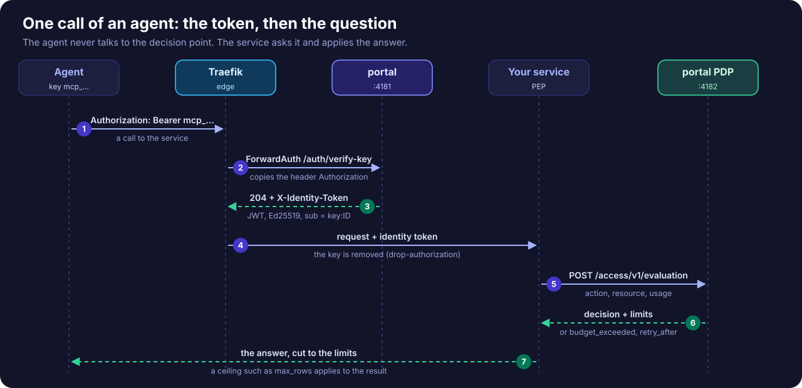

# Identity tokens and the PDP

portal gives an identity token to each service that a user or a key can reach. It also answers the questions of the services about grants, as an AuthZEN policy decision point (PDP). This page describes the token, the PDP, the approval gate, the approval API and the action documents.



The picture shows one call of an agent. The agent sends its key to Traefik. Traefik asks `/auth/verify-key` on portal and gets the identity token. Traefik removes the key and sends the request with the token to the service. The service asks the PDP on port 4182 with one AuthZEN question. It applies the decision and the limits to its answer.

## What portal implements of the protocol

portal follows the [ProcurAuth protocol 1.1](https://procurauth.github.io/procurauth/specification.html) and the [MCP binding](https://procurauth.github.io/procurauth/mcp-binding.html). The protocol is a profile of the AuthZEN Authorization API 1.0. portal has three roles.

| Role | Paragraphs that portal follows |
|---|---|
| PDP | Sections 3 and 4, 5.1 to 5.5, sections 6 to 8, 10.7, 10.7a, 10.7b, 11 and 12 (protocol 1.3). |
| PDP that gives approvals | 17.1 to 17.6 and 17.8 to 17.12. The block `inbox.approvals` starts it. |
| Edge | 1.4, 8.3, 9.1 to 9.3, the second paragraph of 9.4, 9.8 and 9.9. Two routes do it: `/auth/verify` for a person and `/auth/verify-key` for a key. |
| Built-in actions | 1.3a. The service `portal` has actions that no PEP checks (see [Grants and the gate](grants-and-gate.md#the-scope-portal-is-not-a-service)). |
| Caller of the options route | 5.6 to 5.9. The editor of grants asks a service for the children of a node (see "Options of a node"). |

portal is not a PEP, so the paragraphs for a service (sections 10 and 17.7) are the duty of each service. The test suite of portal runs the conformance series D (PDP) and E (edge) of the protocol repository. portal signs tokens with `Ed25519`. It does not sign with `ES256`, which protocol 9.2 also permits.

## Identity token

With the block `identity`, `/auth/verify` gives an identity token (protocol section 9) to each service that a user can open. `/auth/verify-key` gives one to each service that a key can reach. The token is in the response header `identity.header`. The default is `X-Identity-Token`.

Traefik copies the token to the request. Add the header to `authResponseHeaders` of the ForwardAuth middleware. Traefik then removes a header of the same name that the client sends.

```hcl
identity {
  issuer           = "https://portal.example.com"
  header           = "X-Identity-Token"
  token_ttl        = "5m"
  signing_key_file = "/run/secrets/portal_identity_key"
}
```

The token is a JWT. Its header has `alg` `Ed25519`, `typ` `JWT` and `kid`. The `kid` is the RFC 7638 thumbprint of the public key. The claims are:

| Claim | Value |
|---|---|
| `iss` | `identity.issuer` |
| `sub` | The login of the user. The superadmin has its own login. For a key, `sub` is `key:<id>`. |
| `aud` | The id of the service. |
| `iat`, `exp` | The time of issue, and `iat + identity.token_ttl`. Both are whole numbers of seconds. |
| `owner` | The login of the owner of the key. A token for a key has it. A token for a person has no `owner`. A service uses it for logs and for approvals, never for a decision (protocol 9.5). |

The token contains no permission. The service asks the PDP.

- `identity.token_ttl` is from 10 seconds to 1 hour. The default is 5 minutes. It must not be more than the `identity.max_age` of the services.
- portal keeps one token for each session or key and each service. It gives the same token again until half of its life is gone. The table holds 16,384 tokens at most.
- The edge does all its checks again for each request before it gives a kept token (protocol 9.9).
- A path that no service owns gets no token.

Make the key with OpenSSL. Give the public key to each service as a JWK Set (protocol 9.4):

```sh
openssl genpkey -algorithm ed25519 -out portal_identity_key
portal identity-public-key --config /etc/portal/config.hcl > portal_identity_public.jwks
```

The key file holds a PKCS#8 key in PEM format. The file can also hold the base64 text of the PEM on one line. `portal check-config` reads the key and prints the `kid`.

## AuthZEN PDP

With the block `pdp`, portal is an AuthZEN PDP on a second listener. Do not expose this listener through Traefik. Only the services use it.

```hcl
pdp {
  listen_address = "0.0.0.0:4182"
  url            = "http://portal-pdp.edge.svc.cluster.local:4182"
  plain_http     = true
}

pdp_client "db" {
  token_file = "/run/secrets/portal_pdp_token_db"
}
```

An `http` value of `pdp.url` needs `pdp.plain_http = true`. The server stops at start without it. With `plain_http = true`, an `https` URL also stops the server. The start log has a warning when `plain_http` is `true`.

### Endpoints

| Endpoint | Use |
|---|---|
| `POST /access/v1/evaluation` | One decision: `subject`, `action`, `resource`, `context`. The answer is `{"decision": true}` or `{"decision": false}`. A `true` answer can have `context.limits` (the ceilings). For a question with `context.usage`, it also has `context.usage.units`. A `false` answer can have a reason. |
| `POST /access/v1/evaluations` | A batch. The top-level members are the defaults of each item. `options.evaluations_semantic` is `execute_all` (default), `deny_on_first_deny` or `permit_on_first_permit`. The batch has at most `pdp.max_evaluations` items. A request with an empty `evaluations` array is one evaluation. |
| `POST /access/v1/search/action` | The actions that the subject can do on the resource. The resource has the same form as in an evaluation, with its ancestors. The answer is one page. |
| `GET /.well-known/authzen-configuration` | The endpoints under `pdp.url`, and the limits of the PDP (see "The metadata"). This endpoint needs no token. |
| `POST /approval/v1/requests` and two more routes | The approval API (see "The approval API for a service"). |
| `GET /healthz` | The text `ok`, for a probe. It needs no token. |

Any other path gets `404`. A wrong method gets `405`. A request that portal cannot read gets `400` and no decision. The PDP returns the header `X-Request-ID` of the request. The value has 128 visible ASCII characters at most. A bad value gets `400`.

### Who may ask

- Each server has its own `pdp_client` block and its own token. The token has at least 32 bytes. Two servers cannot share a token: the server stops at start.
- The label of the block is the name of the server. The label is the id of its service. This id is also the audience of its identity tokens.
- The server sends `Authorization: Bearer <token>`. A request without a valid token gets `401` with the header `WWW-Authenticate: Bearer realm="portal-pdp"`.
- The PDP answers a server only for its own resources.

### The resource

- The resource `{"type": "service", "id": "<name of the server>"}` is the whole service. It has no `ancestors`, or an empty list.
- A route of a service can run no action of its document, for example a static file. Such a route asks `access` on the whole service, with no usage and no effect (protocol 10.1c). The PDP answers it from the grants of `access`, as for the edge. `confirm` has no effect on `access`, so the answer never has a reason of the approval gate. A health-probe route asks nothing.
- A resource of another type is a node below the service, for example a database. `resource.properties.ancestors` gives the chain from the service to the parent of the node. For example: `[{"type": "service", "id": "db"}, {"type": "host", "id": "local"}]`. The ids are not escaped in a request.
- A node below the service must have this chain. A node of depth 1, for example the host `local`, has the chain `[{"type": "service", "id": "db"}]`. A node without `ancestors`, or with an empty list, gets `invalid_resource`.
- The first ancestor must be the service of the server that asks. Its token tells which server it is. The chain (the ancestors, then the resource) must follow the parents of the last known document of the service. The chain has at most 4 nodes below the service.
- A resource that does not obey these rules gets `{"decision": false, "context": {"reason": "invalid_resource"}}`. An id or a type name that breaks protocol 4.1 or 5.2 gets it too. Examples are an empty id, an id of more than 256 bytes, a control character and the type `service` in the chain. The service of another server gets the same answer.
- This check comes before the search of the login or the key. The superadmin and an unknown user get the same answer.
- An `invalid_resource` answer also starts an early read of the document of the server that asks (see "Actions of the services"). The server can have a new tree that portal does not know yet.

### Coverage and the document

- A grant covers the node that it names and each node below it. The PDP compares the types and the decoded ids of the chain segment by segment, as exact text. The three endpoints use the same rule.
- A grant below the service applies only when the last known document of the service follows it (see [Grants and the gate](grants-and-gate.md#coverage-and-the-resource-tree)). The PDP keeps the last document that it read for each service. A failed read does not remove it.
- A new document that changes the tree removes the effect of the grants that do not follow it, at once. The PDP ignores such a grant. The reason in the log is `no grant` when no other grant applies. A grant on the whole service is not affected.
- If portal has no good document of the service, the decision is `false`, without a reason. This applies to each node and to the whole service. Only a request for `access` on the whole service is not affected.
- Without the document, the PDP cannot apply the ceilings and the budgets of a grant. The reason in the log is `the document of the service is not known`. After a change of the `portal.actions` URL of a service, a failed read leaves no document.
- Without a good document, the PDP still checks the start of the chain. A node without ancestors, or with a first ancestor that is not this service, gets `invalid_resource`.
- `context.match` sets how a grant matches the resource. The default is `"node"`: the rule above. With `"subtree"`, a grant on a node below the resource also gives `true`. For example, a user with a grant on one database of the host `local` gets `true` for the host `local`. The service can then show this host.
- A service uses a `"subtree"` decision only to show or hide a navigation element. Each operation asks with `"node"` on its exact resource (protocol 4.4).
- In a batch, the `context` of an item replaces the `context` at the top of the request (AuthZEN 1.0). An item without `context` uses the top-level one. The action search reads `context.match` too.

### Subjects

- The subject type must be `user`. The subject is an account, the superadmin or a key.
- A subject that the PDP does not know gets `{"decision": false, "context": {"reason": "unknown_subject"}}`. This applies to a login that no account has, and to a subject type that is not `user`. The batch gives the same answer in each item of this kind. A service reads this reason as an orphan: a deleted subject (protocol 11.1).
- An id with a colon is not a login. The id `key:<id>` names a key (protocol 3.2, see [Keys and limits](keys-and-limits.md)). Without the block `keys`, each key gets `unknown_subject`. A key that does not exist, an expired key and a key whose owner does not exist get it too. An id with another prefix gets the same answer.
- A condition of the owner that can change later gives `false` with no reason, never `unknown_subject` (protocol 3.5 and 11.1). These conditions are the right `keys.own.use` of the owner for the kind of the key, and the `max_key_lifetime` of the owner. A service must not read such a key as a deleted key. When the owner gets the right again, or a longer life, the key works again.
- The superadmin has all grants and no limit. The PDP counts no use of the superadmin: `units` is `0`.
- The PDP decides a key from two sides: the grants of the key and the grants of its owner. Both sides must give the action. The limits of both sides apply.

### Reasons

| Reason | Cause |
|---|---|
| `unknown_subject` | The PDP does not know the subject. |
| `invalid_resource` | The resource is not a correct node of the server. |
| `invalid_request` | A batch item has a bad `context.match`, a bad `context.permission_only`, or bad ancestors. |
| `budget_exceeded` | A counter has no room. The answer has `retry_after`. |
| `approval_required`, `approval_pending`, `approval_denied`, `approval_expired` | The action needs the approval of a person (see "The approval gate"). |

No other denial has a reason. The answer is `{"decision": false}`, so that it does not show the grants of a user. The reasons `invalid_resource` and `invalid_request` tell that the request of the service is not correct. They do not show the grants of a user.

A bad `context.match`, or a value that is not a text, gives `{"decision": false, "context": {"reason": "invalid_request"}}` in a batch item. This check comes first. A `resource.properties.ancestors` that is not an array of objects with `type` and `id` gives the same answer. In a request with one evaluation and in the action search, these values get status `400` (protocol 11.1).

### The action search

The action search asks the gate without an effect. For a key, it lists no action that needs an approval: the gate answers `false` with no effect, and the search skips the action. For a person, `confirm` has no effect, so the search lists the action.

### Questions and answers

The PDP fails closed. A request that it cannot read gets status `400` and no decision. The log records each decision with the line `pdp_decision`. The record has the client (the name of the server), the subject, the action and the resource. It also has the match (`node`, `subtree` or `invalid`), the usage, the effect, the decision and the reason. The resource is the chain in the text form of a grant path, with the ids escaped, for example `service:db/host:local/database:analytics`.

The PDP has no TLS. The deployment must limit the network of the PDP to the services and to portal. This differs from AuthZEN, which requires TLS.

In K3s, the NetworkPolicy `allow-portal-pdp` (`deploy/k3s/network-policy.yaml`) admits port 4182 only for the pods with the label `portal-pdp-client: "true"`. These pods must be in the namespace `apps`, `observability` or `edge`. Give this label to the pod template of each server that asks the PDP. The policy `allow-portal-http` opens port 4181 of portal to the Traefik pods and the Prometheus pod only. portal trusts `X-Forwarded-For` from the pod network (`server.trusted_proxies`). No other pod may reach port 4181.

A request about a database of the host `local`:

```json
{
  "subject": {"type": "user", "id": "alice"},
  "action": {"name": "query.run.write"},
  "resource": {
    "type": "database",
    "id": "analytics",
    "properties": {"ancestors": [{"type": "service", "id": "db"}, {"type": "host", "id": "local"}]}
  }
}
```

The same request with `"context": {"usage": {"units": 1}}` is a use. The PDP counts one unit of each budget of the subject. The answer gives the ceilings and the units:

```json
{"decision": true, "context": {"limits": {"max_duration": 30}, "usage": {"units": 1}}}
```

The value `units` is `0` when no budget applies to the subject for this action, and `1` otherwise (protocol 6.12). When a counter has no room, the answer is HTTP 200 with the reason `budget_exceeded` and `retry_after` (protocol 11.1). The value `retry_after` is a whole number of seconds from 1. The PDP never answers `429`:

```json
{"decision": false, "context": {"reason": "budget_exceeded", "retry_after": 12}}
```

Only a request with one evaluation can carry `context.usage` (protocol 6.11). A request that has `usage` at another place, or `usage` with `"subtree"`, gets status `400`. The value of `usage` must be exactly `{"units": 1}`. The PDP gives status `503` and no decision when it cannot read or change a counter (protocol 6.9).

## The metadata

`GET /.well-known/authzen-configuration` gives the endpoints and the limits of the PDP. The limits are the real values of the listener (protocol 6.9, 10.7 and 10.7a). A service reads them and keeps within them.

| Member | Value |
|---|---|
| `procurauth_idle_max_seconds` | `server.header_read_timeout`. The listener closes a connection that sends no request for this time. A service closes its idle connection after half of it. |
| `procurauth_evaluations_max_bytes` | `pdp.max_body_bytes` (default 64 KiB). A larger body gets `400`. |
| `procurauth_evaluations_max_items` | `pdp.max_evaluations` (default 128). A batch with more items gets `400`. A service splits its questions into batches that fit. |
| `procurauth_usage_max_seconds` | `5`. A question with `context.usage` gets a decision or status `503` within 5 seconds. The look at the approval, the count of the units and the consumption of the approval each end within 2 seconds. The count ends within 1 second. |
| `procurauth_directory_max_age_seconds` | With PostgreSQL, `keys.directory_max_age` in whole seconds (default 30). Without the block `keys`, the value is 30. The value is rounded up when the duration is not whole, and it is never 0. When the directory is older, the PDP answers `false` for each key. With SQLite, the value is 1: one process owns the file and changes its directory at each write, so the PDP has no copy (protocol 3.9). |

With the block `inbox.approvals`, the metadata also has the twelve members `procurauth_approval_*` (see "The approval gate").

## The approval gate

A grant with `confirm` makes an action need the approval of a person (see [Grants and the gate](grants-and-gate.md#approval-of-an-action)). The block `inbox.approvals` starts the gate. It needs `inbox.items`, `inbox.at_rest`, `pdp` and `keys.mcp = true`. The service has no flag for it. Each action of each service can ask, and a service must handle `approval_required` for all its actions. Without the block `inbox.approvals`, a grant with `confirm` gives a plain `{"decision": false}`.

```hcl
inbox {
  approvals {
    consume_within = "5m"   # required; evaluation_ttl and deny_cooldown default to "5m"
  }
}

pdp_client "db" {
  token_file = "/run/secrets/portal_pdp_token_db"
}
```

The server puts the effect of the operation in `context.approval.effect`. The effect is `sha256:` and 64 lower-case hexadecimal digits (protocol 17.3). A bad value gets status `400`. The question never holds the operation itself.

The PDP first decides as for a question without an effect. These questions ignore `confirm`:

- a question for the action `access` or the action `mcp.session`;
- a question with `context.match` equal to `"subtree"`;
- a question of a person: the `confirm` of a grant of a person applies to the keys of the person (protocol 17.8);
- a question with `context.permission_only` equal to `true` (see below).

When the decision is true and the action needs an approval, the PDP reads the newest approval. It must have the same server, subject, action, resource and effect:

| State of the approval | Question without `usage` | Question with `usage` (a use) |
|---|---|---|
| None, or already used | `approval_required` | `approval_required` |
| Open (`pending` or `replied`) | `approval_pending` | `approval_pending` |
| Declined, deny time not over | `approval_denied` | `approval_denied` |
| Declined, deny time over | `approval_required` | `approval_required` |
| Abandoned, expired, cancelled, superseded, or not used before `consume_before` | `approval_required` | `approval_expired` |
| Approved and usable | `true`, nothing consumed | `true`, one approval consumed |

A question with an effect, a spent approval and no `usage` gets `approval_required` so that the agent can ask again. A question with no effect for an action that needs an approval gets `approval_required` without an `evaluation_id`. A `false` answer of the gate takes no unit of a budget. When the inbox cannot read its store, a request with one evaluation gets status `503`. A batch item gets a plain `false`.

The answers `approval_required` and `approval_pending` have `context.evaluation_id` when the question had an effect. The server sends this value back when it submits the request. It never reads it.

### The evaluation id

- The `evaluation_id` has at most 1024 bytes (protocol 17.1). A question whose id would be longer gets `false` with no reason. An example is a resource with very long ids. The PDP gives no approval for it.
- The `evaluation_id` holds no state. It has the id of a content key, the time of issue, an HMAC-SHA-256 and the sealed facts of the question. The HMAC covers the server, the subject, the action, the resource, the effect and the time. The facts are the subject, the action and the resource, sealed with the content key.
- A submission has no subject, no action and no resource. The portal reads them from the sealed part. The server sees no fact in clear text. Each instance that has the content keys can check the value.
- The `evaluation_id` is valid for `inbox.approvals.evaluation_ttl`.

### An operation with several permissions

An operation can need several permissions (protocol 5.5a). The question of each permission other than the action of the use has `context.permission_only` equal to `true`, no `context.usage` and no `context.approval`.

- The PDP decides it as for a question without an effect, and it ignores `confirm`. The answer is `true` or `false` with no reason of the gate and no `evaluation_id`. The ceilings of that permission apply to its part.
- The marker with `context.usage`, with `context.approval`, or with another value than `true` gets status `400`. In a batch, the item gets `invalid_request`.
- The PDP trusts the service for the marker, as it trusts it for every member (protocol 12). A service that does not mark such a question gets `approval_required` for it.

### A use

A use is a question with `context.usage` and the effect. The PDP takes three steps (protocol 17.2):

1. It looks at the approval and consumes nothing. When the approval cannot be used, the answer is the reason of the table.
2. It counts the unit of each budget of the subject.
3. It consumes the approval with one compare-and-set in the inbox database. The answer is `true` only after this step.

The counters and the items are in two stores that have no common transaction, so the order is the guard.

- A budget that refuses, or a count that fails, leaves the approval as it was. The answer is `budget_exceeded` or status `503`. The approval stays usable until `consume_before`.
- A crash or a failure between step 2 and step 3 leaves the approval usable and one unit counted (the over-count of protocol 10.6). The agent asks again.
- When the compare-and-set loses a race, or the store fails, the PDP gives the units back. The answer is the reason of the table, or status `503`.
- The PDP never loses an approval because of a failure of its own. It never leaves an approval consumed when the answer is not `true`. It never consumes an approval two times.
- With several callers that use one approval at the same time, one gets `true`. Another caller can get `budget_exceeded` when the budget is just spent.

The decision of the owner sets `consume_before` to the time of the answer plus the larger of `inbox.approvals.consume_within` and `lease_s` of the request. After this time the approval is `lapsed`. After an explicit refusal, the same effect gets `approval_denied` during `inbox.approvals.deny_cooldown`. A void or a used approval starts no deny time. An approval for another effect never depends on it.

The PDP checks the subject and the grants before the approval. A key that is revoked, or a grant that is removed, never gets `true` again, also with an approval that can be used. A revoked key cancels its open requests. A question about another subject, another resource or another effect does not find the approval.

An answer holds the reason and the `evaluation_id` and nothing else. It never shows the owner, the device, the comment or the time of the answer (protocol 17.12).

### Metadata and metrics of the gate

With the block `inbox.approvals`, the metadata of the PDP has these twelve members (protocol 17.4 and 17.4a). The values come from the file. A server that does not know them ignores them.

| Member | Value |
|---|---|
| `procurauth_approval_lease_min_seconds`, `procurauth_approval_lease_max_seconds` | `inbox.items.lease.min`, `inbox.items.lease.max` |
| `procurauth_approval_grace_seconds` | `inbox.items.lease.grace` |
| `procurauth_approval_revive_seconds`, `procurauth_approval_max_revivals` | `inbox.items.lease.revive_window`, `inbox.items.lease.max_revivals` |
| `procurauth_approval_max_life_seconds` | `inbox.items.max_lifetime` |
| `procurauth_approval_wait_max_seconds` | `inbox.items.wait_max` |
| `procurauth_approval_consume_seconds` | `inbox.approvals.consume_within` |
| `procurauth_approval_deny_seconds` | `inbox.approvals.deny_cooldown` |
| `procurauth_approval_evaluation_ttl_seconds` | `inbox.approvals.evaluation_ttl` |
| `procurauth_approval_ref_ttl_seconds` | `inbox.approvals.intent_ttl` |
| `procurauth_approval_max_command_bytes` | `inbox.approvals.max_command_bytes` |

The metric `portal_pdp_approval_total{reason}` counts the outcomes of the gate: `approval_required`, `approval_pending`, `approval_denied`, `approval_expired`, `consumed`, `refunded` and `not_enabled`. The value `refunded` counts the uses that gave their units back because the consumption failed.

The metric `portal_budget_refunds_total{result}` counts the refunds that worked and the refunds that failed. The metric `portal_pdp_decisions_total` has the four reasons too. The journal of the items has the event `approval_consumed`. No line holds a command.

## The approval API for a service

A service that gets `approval_required` or `approval_pending` submits its request to portal. The API has three routes on the listener of the PDP. It uses the bearer token of the block `pdp_client`. It needs the block `inbox.approvals`. Without it, a token gets `403`, and a request without a valid token gets `401`.

The API has no TLS, like the rest of the listener. The command goes in clear text on the pod network, so limit the network of the listener (see `deploy/k3s/network-policy.yaml`).

| Request | Answer |
|---|---|
| `POST /approval/v1/requests` | `201`, or `200` for a request that waits already: `{"request_id", "code", "verdict"}` |
| `GET /approval/v1/requests/{id}?subject=...&wait=...&renew=true` | `200 {"verdict"}` |
| `POST /approval/v1/requests/{id}/keepalive` with `{"subject": "..."}` | `200 {"verdict"}` |

The body of a submission is a JSON object with `evaluation_id`, `effect`, `op`, `view` and exactly one of `approval_ref`, `lease_s` and `until`. It can have `supersedes`, the id of an earlier request of the same subject. A member that is not in this list stops the request. The body is at most `pdp.max_body_bytes`. `op` and `view` are at most `inbox.approvals.max_command_bytes` as compact JSON.

portal checks a submission in this order:

1. The wait: `lease_s` is a whole number of seconds, `until` is a time in RFC 3339 form, and only one of the three is present.
2. The size of the command.
3. The `evaluation_id`: it must be valid, for the server of the token and for the effect of the body. The subject must be a key that the PDP can still use.
4. The effect: portal computes it again from the server of the token, the action, the resource and `op` (protocol 17.3). An `op` with a float, a big integer or a duplicate member name is `invalid_op`. An `op` that is not an object is `invalid_op` too.
5. The `view`: each member is optional (protocol 17.9). A view with no member, `{}`, is valid.
   - A pointer that is present must name a value of `op`. A field names a string, an integer, a boolean or `null`, and the body names a string.
   - A view with no `title` shows the name of the action.
   - A view with no `body` has no command text: the page and the phone say that the service gave no command.
   - A title has 128 characters at most, a label 48 and a pointer 256 bytes. A view has 12 fields at most.
6. The range of the wait. portal never changes a value to fit.
7. An open request for the same server, subject, action, resource and effect. It is the answer: the same `request_id` and `code`, status `200`. It renews no lease and replaces no body.
8. The request to replace, the `approval_ref`, and the limits of the creation (below).

The answer holds `request_id`, `code` and `verdict`, and nothing else. The `verdict` is `pending`, `approved`, `denied` or `void`. A request that waits is `pending`, also with an open question of the owner. An answered request is `approved` or `denied`.

An approval that the server did not consume before `consume_before` is `void`. An abandoned, expired, cancelled or replaced request is `void`. The server never learns which end it is, or why. No route gives a turn, a comment, an approver, a device, a time of an answer or a lease (protocol 17.12). An error has the body `{"error": "<code>"}`. A status `429` also has `retry_after` in whole seconds and the header `Retry-After`.

| Status | `error` | Cause |
|---|---|---|
| 401 | `unauthorized` | No token, or a token that no `pdp_client` block has. The answer has the header `WWW-Authenticate: Bearer realm="portal-pdp"`. |
| 403 | `forbidden` | The block `inbox.approvals` is absent. |
| 404 | `not_found` | An unknown request, a request of another server, or a request of another subject. |
| 405 | `method_not_allowed` | A wrong method. The answer has the header `Allow`. |
| 415 | `unsupported_media_type` | A body that is not `application/json`. |
| 409 | `no_device` | The owner has no phone, and `web_approval` is false. |
| 409 | `cannot_supersede` | The request to replace was consumed. |
| 413 | `command_too_large` | `op` and `view` are above `max_command_bytes`, or the body is above `pdp.max_body_bytes`. |
| 422 | `invalid_argument` | A bad member, or an `approval_ref` that is bad, used, foreign or expired. Also an unknown request to replace. |
| 422 | `lease_required`, `invalid_lease` | No wait, two waits, or a wait outside the range. |
| 422 | `invalid_evaluation`, `effect_mismatch`, `invalid_view`, `invalid_op`, `explanation_required` | A mistake of the server. |
| 429 | `rate_limited` | A limit of the creation (below), a muted key, or a deny time. |
| 503 | `storage_degraded`, `unavailable` | The inbox cannot write. |

The reference PEP of the protocol maps these answers to the errors of its tool:

- `429` gives `approval_rate_limited`.
- `409 no_device` gives `approval_unavailable`.
- `413`, and `422` with `invalid_argument`, `invalid_lease` or `lease_required`, give `invalid_argument`.
- A `404` of a read gives `invalid_argument`.

Any other answer gives its own HTTP `503`. So portal uses the other codes only for the mistakes of the server.

### Wait and renewal

A read renews the lease only with `renew=true`, and only when `subject` is the requester key of the request. The keepalive always renews. A read without `renew` never renews, also late. The server must never renew on a timer of its own (protocol 17.7). portal cannot enforce this rule.

The `wait` is a whole number of seconds. portal bounds it by `inbox.items.wait_max`, and a long `wait` is never an error. A wait ends when the owner answers. The wait holds a connection of the PDP listener, so keep `wait_max` small.

### The intent of an agent

An agent that has a channel to portal makes an intent before the server submits. The intent has the wait (`lease_s` or `until`), an explanation, a `hint`, `allow_custom` and `allow_ask_back`. It can also have `explanation_format` (`plain` or `markdown`) and `language` (the language of the command, for the color). portal returns an `approval_ref`: 32 random bytes in base64url. The agent gives it to the server, and the server sends it with the submission.

portal keeps only the digest of the reference, and it seals the explanation and the hint. The reference works one time, for the key that made it, until `inbox.approvals.intent_ttl` ends. The server cannot read it. An intent has these limits:

- The explanation is at most `max_explanation_chars` characters. The format `markdown` shows a safe subset: see [the phone protocol](inbox/protocol.md), "Text format and code color". An `explanation_format` without an explanation gets `422 invalid_argument`.
- A longer text gets `422 explanation_too_long`, and portal never cuts it. With `require_explanation`, a request without an explanation gets `422 explanation_required`. A submission with no `approval_ref` has no explanation.
- `allow_custom` and `allow_ask_back` need a key with the interaction `conversational`. A key `one_shot` gets `422 interaction_not_allowed`.
- A key has at most `max_requests_per_key_per_hour` intents that wait.
- `previous_id` names an earlier request of the same key that ended. The new request follows it.

### Limits of the creation

portal limits the requests of a key. These limits run in the transaction of the creation, so two instances cannot both pass them:

- `max_requests_per_key_per_hour` requests in one hour. A replacement counts, a repeat of an open request does not. The error is `429` with the time to wait.
- After an explicit refusal, the same key and the same effect get no new request during `deny_cooldown`. The error is `429`. An abandon, an expiry and a cancel start no such time. Another effect never depends on it.
- After `mute_after_refusals` explicit refusals in a row, the key is muted for `mute_for`. An approval ends the row. The owner gets a plain alert on each phone. A muted key gets `429`.
- `inbox.items.max_open_per_key`, `max_open_per_owner` and `max_open_total` limit the open requests. The error is `429`.

A request that replaces another one (`supersedes`) is one transaction. The old request becomes `superseded`, also an approval that was answered and not consumed. A request that was consumed gives `409 cannot_supersede`. A request that is already final stays as it is, and the new request is a plain creation.

The database keeps one open request for each effect: a unique index on `approvals.open_hash` that is NULL after the request ends. The check of the code and the index agree, also with several instances.

The metadata of the PDP has the members `procurauth_approval_ref_ttl_seconds` and `procurauth_approval_max_command_bytes`. The journal has no line with a command or an explanation.

## Actions of the services

portal reads the actions of each service at `/.well-known/procurauth/actions`. The URL comes from the label `portal.actions`. This label is an absolute http or https URL. If the label is absent, the URL is the origin of the health URL (`portal.health`) with this path. A service without these two labels has only `access`.

- The read has a timeout (`access.actions_timeout`, default 2 seconds). It has a size limit (`access.max_document_bytes`, default 256 KiB). portal reads the document again after `access.actions_refresh` (default 5 minutes). It reads at most 64 documents at the same time.
- For an https URL, portal verifies the certificate and the host name with the embedded Mozilla roots. A read that fails this check gives no document. For a service with a private CA, use an http URL on the internal network.
- When the PDP gives `invalid_resource` to a service, portal reads the document of this service again at once. The service can have a new tree that portal does not know yet. portal does this once for each service in each `access.actions_refresh` interval.
- The field `server` of the document must be the id of the service. Set `portal.id` to the name of the server. The id `portal` is reserved.
- A grant of any action can have `confirm`. The document has no member for it, and portal ignores a member `approval`. See [Grants and the gate](grants-and-gate.md#approval-of-an-action).

The document has these rules. A document that breaks one of them is bad as a whole. portal keeps the last good document. The Services page shows the problem.

- The top-level list `resource_types` declares the tree of types (protocol 5.2). Each item has `name`, `parent` and `description`. A name starts with `a-z`, then has `a-z`, `0-9` and `_`, 1 to 32 characters. It is not `service`. The list has at most 16 types.
- The parent of a type is `service` or another declared type. The tree has no cycle and at most 4 levels below `service`.
- Each action has `name`, `resource_types` and `description`. The name is not `access`: portal decides `access` itself. Each type in the list of an action is `service` or a declared type. A type occurs one time in the list of an action. The document has at most `access.max_actions` actions (default 1024).
- The optional list `limits` declares the limits of the service (see [Keys and limits](keys-and-limits.md#limits-of-a-service)). An action names the limits that apply to it in its own list `limits`.
- The optional list `resources` names the nodes of the tree that the service knows, for example its hosts. Each item has `path` (the text form of a grant, for example `host:prod`), an optional `label`, and an optional list `actions`. A path follows the declared types. A path occurs one time.
- Each action of an item lists the type of the node. Without `actions`, the item takes each action that lists its type. The settings pages show each named resource apart, with the actions that apply on it only.
- The list `resources` has 4096 items at most (`access.max_resources`, from 256 to 65,536). The list is not part of AuthZEN. A service that does not give it works as before, and the superadmin types the ids.

```json
{
  "server": "db",
  "resource_types": [
    {"name": "host", "parent": "service", "description": "One database server."},
    {"name": "database", "parent": "host", "description": "One database of a host."}
  ],
  "actions": [
    {"name": "query.run.read", "resource_types": ["service", "host", "database"], "description": "Run read-only queries."},
    {"name": "explorer.read", "resource_types": ["service", "host", "database"], "description": "Browse the databases."}
  ],
  "resources": [
    {"path": "host:prod", "label": "Production"},
    {"path": "host:replica", "label": "Read replica", "actions": ["query.run.read"]}
  ]
}
```

### Failed reads

- A `404` is a failed read like any other (protocol 5.3). portal keeps the last good document. A service that never had a good document has only `access`. For it, `access` is the full permission: portal lets the user in, and the service does no other check.
- Any other failure keeps the last good document, until it is older than `access.actions_max_age` (default 1 hour). After that age, the service has only `access`. The Services settings page shows the problem. The PDP uses the same document: see "AuthZEN PDP".
- The edge never refuses a person or a key because of the age of the document. `access` stays `true` (protocol 8.3). The PDP answers `false` with no reason for each other question of the service.
- While a service has not answered, portal refuses a new grant below it.

### Grants to check

- The Services page lists each grant below a service that does not follow the document of the service, under "permissions to check". The PDP does not apply these grants. The list does not hold the grants of a service that has not answered yet.
- The log also has one warning `grant_to_check` for each such grant. The line has the login, the grant and the problem. portal writes it at the first answer of the service after the start. It writes it again at each change of the document.

### The editor of grants

The page of a user has one editor of grants. The forms of the keys use the same editor (see [Settings pages and history](settings-and-history.md#editor-of-grants)). The editor shows the tree of the resources of a service and the actions of the chosen node. A person does not type the id of a resource: the editor lists the resources. The list comes from the member `resources` of the action document and from the options of the service.

- The editor sends every grant of the account, with its limit values. The form replaces the grants of the account. The grants on the service `portal` (the rights on the keys) have their own form.
- A grant that the document of the service does not name now stays in the editor. The editor shows it, so a person can remove it. A grant of the file shows a lock and cannot change on the page.
- A limit field shows the largest value that the document allows. This is a hint. An empty field gives no value: the limits of the service still apply. The protocol has no default value for a limit.

### Options of a node

A person who opens a node that the action document does not list needs the children of this node. portal asks the service for them: `GET /.well-known/procurauth/resources` at the origin of the action document (protocol 5.6 to 5.9). The request carries the identity token of the person who fills the form, so the service lists only what this person can see.

- The editor calls `GET /auth/options` on portal. portal makes the token only when the person can open the service.
- portal asks for 50 items in one request. It reads an answer of 64 KiB at most.
- portal keeps each answer for 60 seconds in memory. The cache holds 5,000 entries and 32 MiB at most.
- A service that publishes no list, or that does not answer, gives no option. The editor then shows the note "The service lists no resource here."
