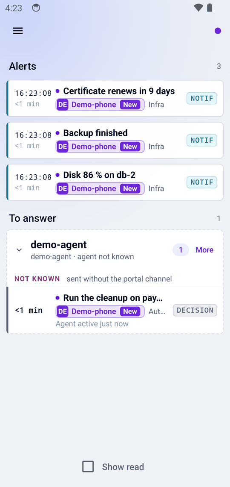
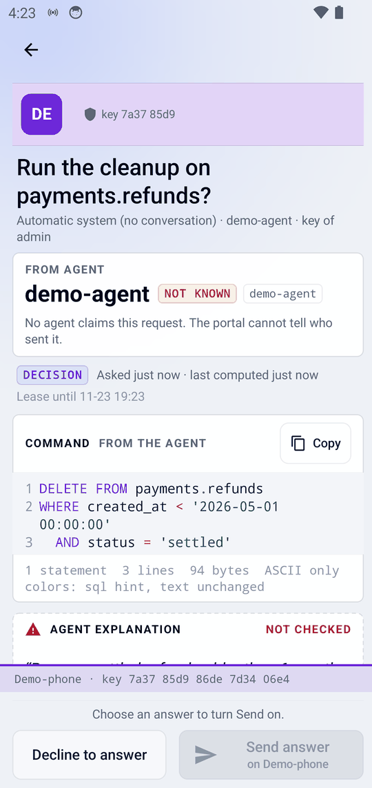

# Android app

The Android app Portal Inbox receives the alerts of one or more portals. It also lets the owner answer the approvals and the questions of agents. This page describes what the app does, how to add a portal, and how to test the app with an emulator.

## What the app does

The app has the name Portal Inbox. Its application id is `app.portalinbox`. It receives alerts and shows the items that agents send. It does not send alerts. It does not use Firebase or any push service of a third party. It keeps one encrypted connection for each server in a foreground service.

One app can enroll in up to 10 portals. The app shows the name that the user chose for each portal, and never the name that the portal gives itself.

For each group, the user chooses one action. This choice stays on the phone.

| Action | Behaviour |
|---|---|
| `alarm` | A loud alarm, in a loop, until the user stops it on the phone. It opens full screen. It overrides silent mode, vibrate mode and do-not-disturb. |
| `ring` | One notification sound, also in silent or vibrate mode. |
| `notify` | A standard notification. It follows the mode of the phone. |

The app lists one more entry, **Direct**, under the groups of the server. It is not a group of the server. An alert that the server sends to one account arrives with the group id `@direct` and the group name `Direct`. The app always lists this entry, also before the first direct alert. Its default action is `ring`. The default is never `alarm`.

The user can choose `notify`, `ring` or `alarm`, or choose **Off**. With **Off**, the app stores the alert in its list and makes no sound and no notification. This choice stays on the phone. The app never subscribes to `@direct` and never unsubscribes from it. The server does not know this action.

The notification of a direct alert uses the same channel as the action: Rings, Notifications or Alarms.

## Permissions

The app asks for these permissions on its first screen.

| Permission | Reason |
|---|---|
| Notifications | Android 13 and later: show alerts. |
| Full-screen alarms | Show the alarm over the lock screen. |
| Ignore battery optimization | Keep the connection alive in Doze. Without it, Android can delay delivery. |
| Do Not Disturb access | Let `alarm` and `ring` override silent mode and do-not-disturb. |
| Display over other apps | Let an alarm open full screen when the phone is in use. |

The app also starts again after a reboot. On some vendor ROMs, give Portal Inbox the permission for background activity. Examples are Xiaomi, Huawei and Samsung. "Force stop" stops the app until the user opens it again. The Inbox then shows the phone as unreachable.

A message of a kind other than `alert` shows as a generic message. The app never drops a message because of its kind. A person cannot change the login of a phone. The app shows it read-only. The source drawings of the app icon are in `assets/brand/`.

The app accepts an address with `http://` or `https://`. For `https://` it uses the trust store of the phone. The manifest lets the app use clear text, because the portal is often on a private network.

## Several portals on one phone

A phone can have 10 portals at most. Each portal has an identity that only you set. The identity has a name, a color, a monogram and a fingerprint. The monogram is the first two letters of the name. The fingerprint comes from the pinned key of the portal. The portal cannot change any of these.

To add a portal:

1. Open the menu, choose **Portals** and press **Add a portal**.
2. Type or paste the code, or tap the link of the code.
3. Read the confirmation screen. Compare the full fingerprint with the fingerprint on the page where the code was made.
4. Type a name of 1 to 16 characters. The app proposes no name. Each portal needs its own name.
5. Choose a color. A color that another portal uses is crossed out.
6. Tick **I know who runs this portal** when the app asks for it.
7. Press **Add portal**. The app uses the code at this step only.

The app asks for the tick when the code came from a link. A link can come from anyone. The app shows which app opened the link. This hint can be false. A link can add a portal. A link can never replace the key or the address of a portal.

The app also asks for the tick when the portal looks like a portal that you already have. The app marks the letters that differ, for example `porta1.example.org` against `portal.example.org`. The app refuses a code that has the key of a portal that you already have.

The list **Portals** shows the name, the host, the start of the key, the state and the last sync of each portal. Drag the handle of a row to change the order. A screen reader can use the actions **Move up** and **Move down**.

Tap a row to open the screen of the portal. On this screen you can rename the portal, choose another color, change the address and enroll the portal again. The row **Settings of this portal** opens the settings of the portal.

Use **Change address** when the portal has a new address, for example when you are not at home. The key stays the same. The phone keeps one address for each portal.

**Remove portal** shows what the phone erases: open requests, answers that are not sent, items in the history and alerts. You confirm one time. The name and the color are free at once.

The app shows **Key changed** when the portal does not prove the key that the phone pinned. A new key is normal after a key rotation or a new install. An attacker at the same address gives the same sign.

Ask the administrator for the new fingerprint by another channel. Then press **Enter a new code** on the screen of the portal. The phone keeps the name, the color and the history. Only the screen of a portal can start this step. A link cannot start it.

## Settings of one portal

The screen **Settings of this portal** has four groups. Open it from the screen of the portal.

- **Notifications** stay on the phone. **Mute this portal** makes the notification of this portal silent, with no pop-up. The items stay in the list. An alarm still rings. **Show the name on the lock screen** is on by default. When the switch is off, the lock screen does not show the name of this portal.
- **Quiet hours** and **Summary** go to the portal. The phone sends them with the frame `set_prefs`. They replace the preferences of your account at this portal. The page **Preferences** of the portal shows the same values.
- **On this phone** has **Keep finished items**. It sets how long the phone keeps the local copy of a finished request of this portal. **Same as all** follows the choice of the app. A shorter value erases the older items at once. The app asks first and gives the number of items.
- **Apply quiet hours and summary to all portals** opens a sheet. Read the next paragraphs before you use it.

When the portal is not connected, the phone keeps the new values and sends them at the next connection. The screen says "Saved on this phone. The portal did not confirm it yet" until the portal has them. A newer change replaces the values that wait. If the portal refuses a value, the screen shows the text of the portal. The phone then drops the change, and the values of the portal apply.

The sheet **Apply to all portals?** has one line for each other portal. The line tells what will happen before you decide.

| Line | What it means |
|---|---|
| **Sent now** | The portal is connected. The phone sends the values at once. |
| **Offline. Sent when it is back.** | The phone keeps the values and sends them at the next connection. |
| **Not connected. Not sent.** | The key changed or the device is revoked. Nothing can go to this portal. |

Tick the portals. Press the button **Apply to** and the number of portals. The phone never does this on its own. Each portal keeps its own account. The values replace the preferences of the account at that portal, also when the login there is not the same. The sheet shows the other login.

The sheet shows the time zone that the phone sends.

## One notification for all portals

The phone shows at most one notification for all items and alerts of all portals. The phone updates it in place. The summary of a portal does not make a second notification and does not make a sound. It adds one line to the same notification, for example "Production: 5 to answer · 3 that wait, oldest 6 days". The count leaves out the requests that you already closed.

The line stays for 24 hours, or until the next summary of that portal. When you remove the notification, a new summary shows it again, with no sound.

## Agents on the phone

The list **To answer** has one group for each agent. A group shows the name of the agent, the key, the last call and the count of its open requests. The name is your name for the agent, else the key name and a number. The portal gives it. The oldest request of a group is its first row.

The groups follow their oldest request. A new agent comes first. The group **Unattributed** comes last. The list **Alerts** stays above.

Tap the header of a group to fold it or to open it again. The phone keeps this choice. The portal does not know it. Tap **More** to open the screen of the agent.

The line **Observed** under a header shows what the agent or its client said about itself. Anyone who holds the key can send the same text. The phone marks each hidden or look-alike character with its code. Do not use this line as proof.

When a new agent calls, the phone shows a card **New agent** above **To answer**.

1. Read the box **Observed, not verified**. Read the amber lines. They say when the text equals the name of an agent that you know.
2. Type a name and press **Name and allow**. Or press **Allow as** to keep the name of the portal.
3. Press **Block** to refuse the agent. The phone asks you to confirm. The portal cancels the open requests of the agent.
4. If the agent is one that you know, press the merge button. Choose the known agent of the same key. A merge cannot be undone.

With `inbox.agents.lock_new = true`, the card shows the line `Approve is locked until you allow this agent.` The approval screen then locks **Approve**. **Decline** still works. By default the portal does not lock a new agent, and the card has no lock line.

The screen of an agent shows its name, key, state, last call, counts, the box of hints and its open requests. It also has **Rename**, **Merge**, **Block** and **Unblock**. The state of the agent decides which of them show. The screen of a portal has the row **Agents**. Use it to find a blocked agent.

The phone sends each action to the portal and waits for the answer. The action stays on the phone until the portal answers, also when the phone is offline. A line at the bottom tells the result. These actions do not ask for your fingerprint. An approval still asks for it.

The approval screen has the box **From agent** under the title. It shows the name, the state and the key. The dashed line "Not verified: Says it is" shows the text of the agent. The agent can change this text at each call.

A new agent adds "1 new agent" to the one notification, and a line "new agent on" with the key name. The lock screen shows only the count. The phone alerts once for each new agent. The notification does not repeat when the portal changes the agent again.

## Questions on the phone

The phone shows a question on its own screen. The owner opens it from the list "To answer", from the list "Done" or from the screen of an agent. Only the owner answers.

The screen has the box "From agent" under the title. The command of the agent comes first, in a fixed font, with a Copy button. The explanation of the agent comes below it. It shows in a dashed zone with the label "Not checked". The phone shows each hidden character of these texts as a mark.

A question is a list of options, a yes or no, a text field, or a form of one to four questions. A list with `multiple` takes the number of ticks that `min` and `max` give. Send stays off until each question has an answer that the server accepts.

The two flags of the agent decide the rows under the options. With no flag, the question is closed: the owner chooses or declines. `allow_custom` adds the row "Other answer". Its text is the answer, and it replaces the ticks.

`allow_ask_back` adds the row "Ask the agent a question". This row opens the discussion and is not an answer. Each free field shows the warning "Do not enter a password or a secret".

A key `one_shot` is an automatic system. Its screen has the header "Automatic system (no conversation)". It shows the suggestion and its confidence above the options. It has no free field and no discussion.

Send asks for the fingerprint or the device PIN. **Decline to answer** asks for nothing. The phone saves the answer in its outbox and sends it again after each reconnection, until the portal gives the result. When the agent is new and `inbox.agents.lock_new` is true, Send stays off until the agent has the state `known`.

The list "Done" shows how each question ended: answered, declined, abandoned, replaced, expired or cancelled. The portal does not send the answer to the other phones. A phone shows what the owner chose only for an answer that it sent itself.

## Test with the emulator

No physical phone is needed for the tests of the app. `tools/android/emulator.sh` runs an Android 14 emulator in Docker. It needs `/dev/kvm`.

1. Build the app: `tools/build.sh apk`. The script `tools/android/build-apk.sh` lists the variables for the key of the APK.
2. Start the emulator: `tools/android/emulator.sh start`. The script installs `dist/portal-inbox-<version>.apk`, grants the permissions and prints the address of the screen. Open <http://localhost:6080> in a browser.
3. Start the stack (see `deploy/README.md`). Publish the port of the portal to the network: `PORTAL_BIND=0.0.0.0`.
4. Set `inbox.devices.public_address` to `http://172.17.0.1:<port>`. This address is the host as the emulator sees it through the Docker bridge.
5. Make a code in the tab Inbox. Open its link on the phone: `adb shell am start -a android.intent.action.VIEW -d '<link>'`.

`emulator.sh logs` shows the logs of the app. `emulator.sh install` installs a new build. `emulator.sh stop` removes the emulator. Sound, vibration and the battery savers of vendors can be judged only on a real phone. If the noVNC page shows a JavaScript error from a `chrome-extension://` script, open the page in a private window. The demo in `demo/` can also be used.

See `demo/README.md`.
