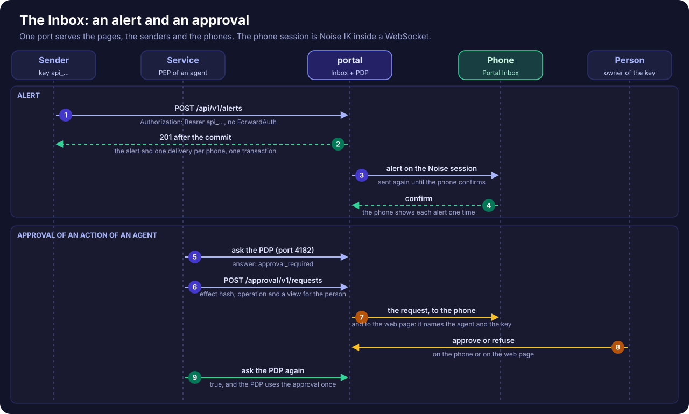
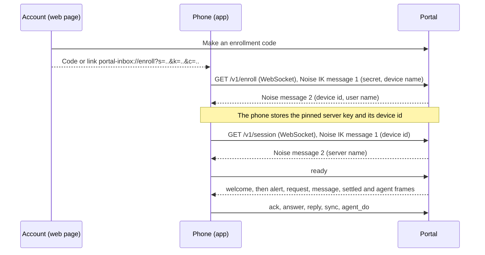

# Device protocol (version 5)

This page describes the protocol between the Inbox of the portal and the Android app Portal Inbox: enrollment, the Noise session, and the frames. It is for the author of a client or of a test.

The code is the reference: [`crates/inbox-core/src/proto.rs`](../../crates/inbox-core/src/proto.rs),
[`enroll.rs`](../../crates/inbox-core/src/enroll.rs) and [`noise.rs`](../../crates/inbox-core/src/noise.rs).
The same crate runs on the server and in the Android app (JNI). The cryptography exists only once.

All messages are JSON. Binary fields are standard base64 with pad characters.
This document describes protocol version 5. An app that speaks another version
gets close code 4426 and must be updated. Protocol 5 has no compatibility with protocol 4.

Protocol 4 replaced the shared device password with a one-time enrollment
code. An account of the portal makes the code. The login of the account is the
user name of the device. The device cannot change it.

Protocol 5 adds items that the owner answers: questions and approvals. It adds the effect hash,
the thread of an item and the preferences of the account. It adds no cryptography.

Protocol 5 also adds the agents of a key. An agent is one program, or one conversation of a model, that asks.
Several agents can share one key. The portal gives each agent an id, and the owner gives it a name.
The frames of this document tell the phone which agent asked, and let the owner act on an agent.

## Overview

A phone talks to the portal over one WebSocket connection. The content of the connection is a Noise session.
The phone pins the public key of the server at enrollment, so only the real portal can answer it.





1. An account of the portal makes an enrollment code. The code holds the address of the portal, its public key and a one-time secret.
2. The phone enrolls with the code. It makes its own key pair. The server links the device to the account.
3. At each connection, the phone proves its key and opens a session. The server sends the frames of the account to it.
4. The phone sends a receipt for each frame. The server sends a frame again until the receipt arrives.

## Keys

| Key | Where | Created by |
|---|---|---|
| Server Noise static key (X25519) | server key file | the command `portal inbox keygen` |
| Device Noise static key (X25519) | phone only | the phone, at enrollment |
| Enrollment secret (16 random bytes) | enrollment code; the server keeps only a digest | the server, for one account |

The server key file holds one line: the base64 of the 32 bytes of the private key.
The public key is derived. If the file is replaced, every device and every code is invalid.

## Enrollment code

The code is one text. It is also a deep link that the app opens.

```text
portal-inbox://enroll?s=<address>&k=<server key>&c=<secret>
```

| Key | Value |
|---|---|
| `s` | Public base URL of the portal, percent-encoded (UTF-8). Same rules as the app: `host:port`, a domain, or an http(s) URL with an optional path prefix. The app adds `/v1/enroll` and `/v1/session`. 1 to 512 bytes, no white space, no control character. |
| `k` | Public key of the server. Base64url, no pad characters, 32 bytes. |
| `c` | Secret. Base64url, no pad characters, 16 random bytes. |

- The scheme and the host are lower case. Each of `s`, `k` and `c` appears exactly once.
- An unknown key, a duplicate key, a fragment, a wrong length or a bad base64 form is an error.
- White space around the whole text is ignored.
- The key `k` is the pin. The app trusts no other key for this server.
- The app shows the address and the fingerprint of `k` before it connects. The fingerprint is
  the first 20 hexadecimal characters (80 bits) of the SHA-256 digest of the 32 bytes of `k`,
  in five groups of 4 characters. The person can compare it with the value of the administrator.
- The secret never leaves the core. Kotlin code does not see it.

## Enrollment: `GET /v1/enroll` (WebSocket, binary frames)

`Noise_IK_25519_ChaChaPoly_BLAKE2s`, prologue `portal-inbox/v1/enroll`.
Each binary frame carries one Noise message (65535 bytes at most).
The device static key is new.
The phone makes it for this enrollment.
The remote static key is the key `k` of the code.

```text
device                                           server
  Noise message 1
   {"protocol":5,"secret":b64,
    "device_name":s,"app_version":s}          ->   finds the code, stores the device
                                              <-  Noise message 2
                                                   {"protocol":5,"device_id":hex32,
                                                    "server_name":s,"user_name":s}
```

1. Device to server, Noise message 1. The `secret` is the standard base64 (with pad characters)
   of the 16 bytes. `device_name` has 1 to 64 bytes and no control character.
   `app_version` has 1 to 64 bytes and no control character.
2. Server to device, Noise message 2. `device_id` is 32 lowercase hexadecimal characters.
   `server_name` and `user_name` are not empty. `user_name` is the login of the account.
3. The device is enrolled only after it reads message 2. Then it stores the address,
   the pinned key, the device id, the device key pair and the user name.
4. The server stores the device key and links it to the account before it sends message 2.
   If message 2 does not arrive, the code is used and the phone needs a new code.

**Refusal.** On refusal the server sends no message 2. It closes the WebSocket with a close code.

| Close code | Cause | Text in the app |
|---|---|---|
| 4410 `ENROLL_REFUSED` | The code is unknown, already used or expired. Message 1 cannot be read or is not valid. The limit `inbox.devices.max_devices` or `inbox.devices.max_per_account` is reached. | "The code is not valid. Ask for a new one." |
| 4426 `PROTOCOL` | Message 1 is valid but `protocol` is not 5. The first frame is a text frame. | "Update the app." |
| 4429 `RATE_LIMITED` | Too many attempts from this address. | "Too many attempts." |

The server uses the same code 4410 for all causes of refusal.
Then an observer cannot tell a used code from an unknown code.
The log of the server has the real reason (event `enroll_refused`).
The server closes with 4429 after the upgrade.
It does not answer the HTTP status 429 to the upgrade request.

A storage error closes with 1011, and the code stays unused.
The server SHOULD close a connection that sends no message within 10 seconds.

Security properties:
- Only the holder of the server key can read message 1. The secret is safe from a passive observer.
- Only the holder of the server key can make a valid message 2 for this handshake.
  A message 2 from an earlier handshake, from another key or after a change is refused.
- A replay of message 1 is not useful. The secret works one time.
- The code is a bearer secret until the first use. Show it only to its owner.

## Session: `GET /v1/session` (WebSocket, binary frames)

`Noise_IK_25519_ChaChaPoly_BLAKE2s`, prologue `portal-inbox/v1/session`. Each WebSocket
binary frame carries exactly one Noise message (at most 65535 bytes).

1. Device to server, Noise message 1 that holds
   `{"protocol":5,"device_id":hex32,"app_version":s}`.
2. Server to device, Noise message 2 that holds `{"protocol":5,"server_name":s}`.
   The device rejects any key other than the pinned server key.
3. Device to server, first transport frame `{"t":"ready"}`. Only after this does
   the server count the session as established, so a replayed message 1 cannot
   displace a live session.
4. Server to device: `welcome`, then the frames of the sections below.

The server closes a session that does not send `ready` within 15 seconds of the upgrade, with the code 1001.
A ping or a pong does not extend this time.
A handshake that proves no enrolled device counts as a failure of the client address.
When the address has too many failures, such a handshake gets 4429.
A device that proves its key always gets its session.

A client address has at most `inbox.devices.max_handshakes_per_address` handshakes on both routes.
A new handshake of a full address ends the oldest handshake of this address with the code 1013.

## Rules of all frames

Each frame is one JSON object in one Noise message. The member `t` names the frame.
The plain text of a frame has at most 65519 bytes (`MAX_PLAINTEXT`).

- **Closed schema.** A parser refuses an unknown frame, an unknown member and a duplicate member.
  A frame that fails a check closes the session with an error, never a repair.
- **No signature.** No frame has a signature. The proof of an answer is the authenticated session
  and the effect hash in `shown_effect`.
- **No new cryptography.** The text of a frame is clear text inside the Noise session.
  No frame goes to a service. The service of an approval never speaks protocol 5.
- **Ids.** An id of an item, of a thread, of a delivery or of a device is 32 lowercase hexadecimal characters.
- **Times.** A time is an integer of Unix milliseconds. It is 0 or more.
- **Texts.** A limit in characters counts Unicode scalar values. A limit in bytes counts UTF-8 bytes.
  A line has no control character. The core crate gives `decode` and `encode` for each direction.
  Each one applies all the rules of this document.
- **Size.** The sender checks the size of the encoded frame. JSON escapes make a control character 6 bytes long.
  The server refuses an item at creation when its frame is too large.
- **Optional members.** An optional member is absent when it has no value. A parser also accepts `null`.

### Device to server

| `t` | Members | Use |
|---|---|---|
| `ready` | none | First transport frame. |
| `ack` | `id`, `stage` (`received`) | Delivery receipt. See "Receipts". |
| `subscribe` | `group` | Subscribes this device to the group. |
| `unsubscribe` | `group` | Removes the subscription. |
| `ping` | `nonce` (u64) | Heartbeat. The server answers `pong`. |
| `answer` | see "answer" | The only answer of an item. |
| `reply` | `request_id`, `client_msg_id`, `text` | A question of the owner to the agent. |
| `refresh` | `request_id` | Asks for the current state of one item. |
| `sync` | `open[]` of `{request_id, seq}`, `agents[]?` of `{agent_id, rev}` | Tells the items and the agents that the device holds. |
| `set_prefs` | `quiet?`, `digest?` | Replaces the preferences of the account. |
| `agent_do` | see "agent_do" | An action of the owner on an agent. |

### Server to device

| `t` | Members | Use |
|---|---|---|
| `welcome` | see "welcome" | First frame of a session. |
| `alert` | see "alert" | A one-way message. |
| `request` | see "request" | An item that waits for the owner. |
| `message` | see "message" | A turn in the thread of an item. |
| `settled` | see "settled" | An item is final. |
| `digest` | see "digest" | The count and the age of the open items. |
| `answer_result` | see "answer_result" | The result of an `answer` or a `reply`. |
| `agent` | see "agent" | The state of one agent. |
| `agent_result` | see "agent_result" | The result of an `agent_do`. |
| `subscriptions` | `subscriptions[]` | The groups of the device, after each change. |
| `pong` | `nonce` | Answer to `ping`. |
| `error` | `code`, `message` | A refusal. |

The messages `set_user_name` and `user_name` do not exist.
The server refuses an unknown message.
The codes of `error` are `unknown_group`, `forbidden_group`, `unavailable`, `not_enabled` and `invalid_prefs`.
`unknown_group`: the group does not exist.
`forbidden_group`: the account has no permission `inbox.receive` on the group.

`unavailable`: the storage or the rights are not ready, so send the message again later.
`not_enabled`: the server does not handle this frame.
`invalid_prefs`: a value of `set_prefs` is not valid. The server stored nothing. The message names the field.

A server without the blocks `inbox.items` and `inbox.at_rest` answers each of `answer`, `reply`, `refresh`, `sync`, `set_prefs` and `agent_do` so.
A server with items and without the block `inbox.agents` answers `agent_do` with `agent_result` and the status `not_enabled`.

## Receipts

The server sends `alert`, `request`, `message`, `settled`, `digest` and `agent` from one queue.
Each row of the queue has an id of 32 hexadecimal characters. The receipt `ack` names this id.

| Frame | Member that holds the id of the delivery |
|---|---|
| `alert` | `alert_id` |
| `request`, `message`, `settled`, `digest`, `agent` | `id` |

The device stores the frame durably before it sends `ack`. It deduplicates on the id of the delivery.
The server sends a row again until the receipt arrives. A receipt is idempotent.

Each device of an owner gets the same id for the same message, and each device has its own receipt.
The frames that answer `refresh` and `sync` have a new id that is in no queue. The device stores them as any frame.

The frames `answer_result` and `agent_result` have no delivery id, and the device sends no receipt for them.
The server ignores a receipt for an id that it does not know.
The field `alert_id` of `ack` in protocol 4 is now `id`. The old name is not valid.

## Frames of the server

### `welcome`

```json
{"t":"welcome","server_name":"Prod","groups":[{"id":"infra","name":"Infra","description":"Servers"}],
 "subscriptions":["infra"],"heartbeat_interval_ms":15000,"offline_warning_after_ms":60000,
 "server_time_ms":1788000000000,"user_name":"alice",
 "prefs":{"quiet":{"from":"22:00","to":"07:00","tz":"Europe/Paris","high_rings":true},
          "digest":{"mode":"daily","at":"09:00","tz":"Europe/Paris"}},
 "body_purge_after_ms":2592000000}
```

| Member | Type | Rule |
|---|---|---|
| `server_name` | string | Not empty. |
| `groups[]` | `{id, name, description}` | Only the groups that the account may subscribe to. |
| `subscriptions[]` | string ids | Groups of this device. |
| `heartbeat_interval_ms`, `offline_warning_after_ms` | u64 | |
| `server_time_ms` | i64 | |
| `user_name` | string | Login of the account. Read-only. |
| `prefs` | object | The preferences of the account. `{}` when the account has none. See "Preferences". |
| `body_purge_after_ms` | u64 | Age at which the server erases the body of a final item. 0: the server has no items. |

The server reads `prefs` in the table of the account at each session. A phone that sent `set_prefs` gets its values back here.

### `alert`

```json
{"t":"alert","alert_id":"c0c0c0c0c0c0c0c0c0c0c0c0c0c0c0c0","kind":"alert","group":"infra","group_name":"Infra",
 "title":"Disk full on a node","created_at_ms":1788000000000}
```

| Member | Type | Rule |
|---|---|---|
| `alert_id` | id | Id of the delivery. |
| `kind` | string | Always `alert`. A parser refuses any other value in this frame. |
| `group`, `group_name` | string | An alert to one account has `@direct` and `Direct`. |
| `title` | string | One line, 1 to 128 characters, no control character. |
| `created_at_ms` | time | |

### `request`

A `request` is an item that waits for the owner. The same `request_id` can come again with a higher `seq`.
The frame is then the new state of the item, for example after a revival. The device keeps one item for each `request_id`.
A frame has the members of its kind only. The kinds of this frame are `question` and `approval`.

Members of both kinds:

| Member | Type | Rule |
|---|---|---|
| `id` | id | Id of the delivery. |
| `request_id` | id | Id of the item. |
| `kind` | string | `question` or `approval`. |
| `chain_id` | id | Id of the thread. The first item of a thread has `chain_id` equal to `request_id`. |
| `seq` | u64 | Number of the last turn of the thread. 0 when there is no turn. |
| `from` | object | `{label, key_name, owner, via, interaction, agent_id, agent_kind, agent_state}`. See below. |
| `urgency` | string | `low`, `normal` or `high`. |
| `quiet` | bool, optional | True when the item came inside the quiet hours of the account, in the time zone of the window. The server never holds an item back. The flag does not depend on `urgency`: the phone reads `high_rings` of its preferences. |
| `created_at_ms`, `chain_created_at_ms`, `agent_seen_at_ms` | time | |
| `lease_mode` | string | `lease` or `until`. |
| `lease_until_ms` | time | With `lease` only. |
| `until_at_ms` | time | With `until` only. |
| `allow_custom` | bool | A question: a text can be the answer. An approval: a text can come with a decline. |
| `allow_ask_back` | bool | The owner can ask the agent a question with `reply`. |
| `supersedes`, `previous_id` | id, optional | The item that this one replaces. The item that this one follows. |
| `agent_label` | string, optional | What the agent says that it is. Text of the agent, not verified. 1 to 64 characters, one line, with no control character, no format character and no line separator. |

`from` holds these members:

| Member | Type | Rule |
|---|---|---|
| `label` | string | One line, 1 to 64 characters. The portal computes it. It is the name that the owner gave to the agent, else the key name and the number of the agent (`ops-key #4`). For the bucket, it is the key name when the key has the mode `key`, else `Unattributed · ` and the key name. |
| `key_name` | string | The name that the owner gave to the key. One line, 1 to 64 characters. |
| `owner` | string | Login of the owner. One line, 1 to 64 characters. |
| `via` | string | `mcp` or `api`. |
| `interaction` | string | `conversational` or `one_shot`. |
| `agent_id` | id | The agent of the item. It is the key of a group on the screen. For the bucket, it is the id of its row. |
| `agent_kind` | string | `agent` or `bucket`. The bucket is the pseudo agent "Unattributed" of a key: it holds the items that no agent claims. |
| `agent_state` | string | `new` or `known`. A bucket is `known`. The open request of a `blocked` or a `merged` agent does not exist, so no frame has these states here. |

An item of a `one_shot` key has `allow_custom` and `allow_ask_back` false.

The portal writes each member of `from` itself. None of it is text that an agent sent.
A label that the agent gives never enters `from`: it is in `agent_label`, next to the explanation.
The screen shows `agent_label` in a box marked "Not verified", and never as the name of the agent.
A key that the portal does not find has the name `key` and the first 8 characters of its id.

The server writes `agent_label` from the sealed body of the item. It leaves the member out when the body has no label.

Members of a question:

| Member | Type | Rule |
|---|---|---|
| `title` | string | One line, 1 to 128 characters, no control character, no bidi control, no line separator. |
| `explanation` | string, optional | Text of the agent, 1 to 8000 characters. |
| `explanation_format` | string, optional | `plain` (the default) or `markdown`. Only with `explanation`. See "Text format and code color". |
| `command` | `{text, label?, language?}`, optional | `text` has 1 to 32768 bytes. `label` is one line of 1 to 32 characters. `language` is a hint for the color. See "Text format and code color". |
| `input` | object | See below. |
| `hint` | object, optional | `{suggested, confidence?, source}`. `suggested` and `source` are lines of 1 to 32 characters. `confidence` is from 0 to 1. |
| `as_of_ms` | time, optional | The time of the data in the question. |

`input` holds `type` (`choice`, `confirm`, `text`, `none` or `form`), `multiple` (bool), `min` and `max` (0 to 255), `options[]`, `placeholder?` and `questions[]?`.
A `choice` has 2 to 8 options.
Each option is `{id, label, description?}`.
`id` has 1 to 32 characters of `a-z 0-9 _ -` and is unique.
`label` has 1 to 48 characters.

`description` has 1 to 160 characters.
For a `choice`:
`1 <= min <= max <= number of options`.
Without `multiple`, `min` and `max` are 1.
The other types have no option, `multiple` false and `min` and `max` 0.

Only `text` can have a `placeholder` of 1 to 128 characters.
A `text` question has `allow_custom` false.
A `none` question has both flags false.
Only a `form` has `questions`. See "Forms".

Members of an approval: the member `approval` only.

| Member of `approval` | Type | Rule |
|---|---|---|
| `code` | string | 4 to 8 characters of `A-Z 0-9`. |
| `service` | string | One line, 1 to 64 characters. |
| `action` | string | One line, 1 to 128 characters. |
| `resource` | string | 0 to 512 characters, no control character. Empty: the service itself. |
| `subject` | string | One line, 1 to 128 characters. |
| `effect` | string | `sha256:` and 64 lowercase hexadecimal digits. See "Effect". |
| `op` | object | The operation. Strict rules of the effect. `op` and `view` together have at most 32768 bytes. |
| `view` | object | `{title?, fields?, body?, body_label?}`. Each member is optional. See "Effect". |
| `explanation` | string, optional | Text of the agent, not verified. 1 to 8000 characters. It is not part of the effect. |
| `explanation_format` | string, optional | `plain` (the default) or `markdown`. Only with `explanation`. |
| `language` | string, optional | A hint for the color of the command. It is not part of the effect. See "Text format and code color". |
| `hint` | object, optional | As for a question. |
| `previous` | `{approved_at_ms, consumed}`, optional | The same service, subject, action, resource and effect were approved earlier. `consumed` tells whether the service used it. |
| `follows` | `{code, intent}`, optional | The item follows an earlier item that the owner declined with a text. The server reads it from `previous_id`. |

The command of an approval is the value that `view.body` points to in `op`. It is not in the frame a second time.
The device computes the effect again from `service`, `action`, `resource` and `op`.
It shows "Invalid request" when the result differs from `effect`, or when a pointer of `view` names no value.

```json
{"t":"request","id":"aaaa...","request_id":"bbbb...","kind":"approval","chain_id":"bbbb...","seq":0,
 "from":{"label":"claude-laptop","key_name":"claude-laptop","owner":"alice","via":"mcp","interaction":"conversational","agent_id":"a1a1...","agent_kind":"agent","agent_state":"known"},
 "urgency":"high","created_at_ms":1788000000000,"chain_created_at_ms":1788000000000,"agent_seen_at_ms":1788000001000,
 "lease_mode":"lease","lease_until_ms":1788000180000,"allow_custom":true,"allow_ask_back":true,
 "approval":{"code":"K7QF","service":"datastore","action":"data.write",
  "resource":"host:prod/database:analytics","subject":"key:claude-laptop","effect":"sha256:...",
  "op":{"tool":"run_write_query","host":"prod","sql":"INSERT INTO analytics.events SELECT 1"},
  "view":{"title":"ClickHouse write","fields":[["Host","/host"]],"body":"/sql","body_label":"SQL"},
  "explanation":"The migration needs this row."}}
```

The complete frames are in `crates/inbox-core/tests/fixtures/frames/`.

### `message`

A turn in the thread of an item.

| Member | Type | Rule |
|---|---|---|
| `id` | id | Id of the delivery. |
| `request_id` | id | |
| `seq` | u64 | Number of the turn, 1 or more. |
| `by` | string | `agent` or `user`. |
| `created_at_ms` | time | |
| `explanation` | string, optional | With `agent`. 1 to 8000 characters. |
| `explanation_format` | string, optional | With `agent` and `explanation`. `plain` (the default) or `markdown`. |
| `command` | `{text, label?, language?}`, optional | With `agent`. As in a question. |
| `text` | string | With `user` only. 1 to 8000 characters. It is always plain text. |

An agent turn has `explanation`, `command` or both. A user turn has `text` and nothing else.

### `settled`

An item is final. The device removes it from the list "to answer" and withdraws its notification.

| Member | Type | Rule |
|---|---|---|
| `id` | id | Id of the delivery. |
| `request_id` | id | |
| `state` | string | `answered`, `abandoned`, `expired`, `cancelled` or `superseded`. |
| `reason` | string | 1 to 32 characters of `a-z 0-9 _`. See below. |
| `by` | `{via, device_name?}`, optional | `via` is `phone` or `web`. `device_name` is a line of 1 to 64 characters, with `phone` only. |
| `superseded_by` | id, optional | With `superseded` only. |
| `decision` | string, optional | `approve` or `deny`. With `answered` only, for an approval. |
| `at_ms` | time | |

The reasons that the server sends now are `answered`, `lease_lapsed`, `until_reached`, `max_lifetime`,
`agent_cancelled`, `agent_blocked`, `key_revoked`, `owner_deleted`, `admin_cancelled`, `superseded` and `item_gone`.
`item_gone` answers a `refresh` or a `sync` for an item that the server does not hold any more. The item is `cancelled`.

The phone that answered gets `answer_result`, not `settled`. The server sends `settled` to the other phones of the owner.
A later version can add a reason. A device shows a reason that it does not know as it is.

### `digest`

The open items of the owner, as numbers. It has no body. The server sends no empty digest.
It sends the frame at the due time of the digest of the account. The default is `inbox.items.digest`, and the preferences of the account replace it.

A `daily` digest is due at `HH:MM` of each local day of its time zone. An `every` digest is due at the multiples of its period since the Unix epoch.
Several instances of the server send one frame for each owner and due time.

| Member | Type | Rule |
|---|---|---|
| `id` | id | Id of the delivery. |
| `count` | u32 | Number of open items, 1 or more. |
| `oldest_created_at_ms` | time | |
| `ids[]` | ids | The oldest first. At most 200. Not more than `count`. |

### `answer_result`

The result of an `answer` or a `reply`.

| Member | Type | Rule |
|---|---|---|
| `request_id` | id | |
| `client_msg_id` | string | The value of the frame of the device. |
| `status` | string | See the table below. |
| `state` | string, optional | The state of the item: `pending`, `replied`, `answered`, `abandoned`, `expired`, `cancelled` or `superseded`. |

| `status` | Result |
|---|---|
| `accepted` | The server took the frame. An `answer` is then the only answer of the item. |
| `already_answered` | Another answer won. The same `client_msg_id` sent again also gets this status. |
| `closed` | The item is final in another way. A question gets `closed` with no `state` when the answer does not fit it: an option that the question does not have, a wrong number of ticks, or a text where a choice is due. The server writes nothing, and the device drops the entry of its outbox. |
| `abandoned`, `superseded`, `expired`, `cancelled` | The item is in this state. |
| `effect_mismatch` | `shown_effect` is not the effect of the item. |
| `device_revoked` | The device is revoked. The state of the item does not change, and the server closes the session with 4403. |
| `custom_not_allowed` | The item has `allow_custom` false, and the frame has a text. |
| `ask_back_not_allowed` | The item has `allow_ask_back` false, or the thread has the most turns that the file allows. |
| `agent_locked` | The agent of the item is `new`, and `inbox.agents.lock_new` is true. The frame was an `accept`. The item stays open and nothing is written. A `decline` and a `reply` work. |

A `reply` or an `answer` for an item that the owner does not have gets `closed` and no `state`.
A frame that the server cannot handle now (the storage is away) gets the `error` frame `unavailable`. The outbox sends it again.

### `agent`

The state of one agent. The device keeps one agent for each `agent_id`. It ignores a frame with a `rev` lower than the one that it holds.

```json
{"t":"agent","id":"aaaa...","agent_id":"d4d4...","rev":3,"key_name":"ops-key","kind":"agent","state":"new",
 "label":"ops-key #4","named":false,"created_at_ms":1788000000000,"last_seen_ms":1788000500000,"open":1,
 "lock_accept":true,
 "observed":{"says":"billing-bot","says_changed":1,"client":"claude-code/2.1.0","net":"203.0.113.0/24","nets_seen":2},
 "similar":{"agent_id":"a1a1...","label":"Billing bot"}}
```

| Member | Type | Rule |
|---|---|---|
| `id` | id | Id of the delivery. |
| `agent_id` | id | |
| `rev` | u64 | From 1 to 9223372036854775807. It grows at each change that a device must see. |
| `key_name` | string | One line, 1 to 64 characters. |
| `kind` | string | `agent` or `bucket`. |
| `state` | string | `new`, `known`, `blocked` or `merged`. |
| `label` | string | The text of the portal for this agent. The same rule as `from.label`. 1 to 64 characters. |
| `named` | bool | True when the owner gave a name. Without a name, `label` is the key name and the number of the agent. |
| `merged_into` | id, optional | With `merged` only, and then always. The agent that received the items. The device moves its items and follows the chain until an agent that is not `merged`. |
| `created_at_ms`, `last_seen_ms` | time | |
| `open` | u32 | The number of open items of the agent when the server built the frame. A change of `open` does not raise `rev`. The device counts the items that it holds. |
| `lock_accept` | bool | True only with `new` and with `inbox.agents.lock_new` true. The server refuses `accept` for the items of this agent: the screen disables the button. |
| `observed` | object, optional | The hints of the agent. A bucket has none. All text in it came from a client: it is not verified. |
| `similar` | `{agent_id, label}`, optional | With `new` only. A known agent of the same key that looks like this one. `label` follows the rule of `label`. It is a hint, and never a merge. |

`observed` has these members:

| Member | Type | Rule |
|---|---|---|
| `says` | string, optional | The last text that the agent said about itself. One line, 1 to 64 characters, with no control character, no format character and no line separator. |
| `says_changed` | u32, optional | How many times `says` changed. 1 or more. Absent when it never changed. Only with `says`. |
| `client` | string, optional | The name of the client. The same rule as `says`, with 1 to 64 characters. |
| `user_agent` | string, optional | The header `User-Agent`. The same rule as `says`, with 1 to 128 characters. |
| `net` | string, optional | The address range of the client: a /24 for IPv4 or a /48 for IPv6. The same rule as `says`, with 1 to 43 characters. |
| `nets_seen` | u8 | The number of distinct ranges seen with the token of the agent, 0 to 8. Always present. |

The server leaves out an `observed` text that does not follow the rule: a bad hint never stops the frame.
It leaves out `observed` when there is nothing to show.
The first text of the agent (`says_first` in the engine) is for the page of the owner and is not in the frame.
The server fills `similar` for a `new` agent when a known agent of the same key and the same owner matches it. The match has two rules:

- The two agents say the same text, after NFKC, lower case and one space for each run of white space.
- The two agents have the same client and the same address range.

A match on the text wins over a match on the client. With several matches, the agent that called last wins, then the lower `agent_id`. A blocked or merged agent is never a candidate.

The server builds `similar` when it builds the frame, so a rename of the known agent shows in the next frame of the new agent.
A rename does not raise `rev` of the new agent. A device that wants the new name asks again with `sync`, or waits for the next change of the new agent.
A device must show the sentence "Hints can be copied" with `similar`. The device must never merge by itself.

A bucket has the state `known`, `named` false, no `observed`, no `similar` and no `merged_into`.
The server sends the frame of a bucket in the answer to a `sync` only: it never changes.
The label of a bucket depends on the mode of its key. The server computes it when it builds the frame.

**When the server sends it.** The server writes one message for each device of the owner after each change that raises `rev`:
a new agent, new hints and each action of the owner (a merge also writes one for the target).
It sends the message from the queue, with a receipt, so the notice of a new agent is not lost.

The frame holds the state of the agent when the server sends it. The server withdraws a message with an older `rev` when a newer message waits.
A message goes to the devices of the owner of the agent and to no other device.

An action that changes nothing writes no message. A portal without the block `inbox.agents` sends no `agent` frame.

The device must notify the owner once, for a `new` agent that it did not hold before. A frame that comes again with the same `rev` must not notify again.

### `agent_result`

The result of an `agent_do`. It has no delivery id: the device sends no receipt.

```json
{"t":"agent_result","client_msg_id":"m-0010","agent_id":"d4d4...","status":"ok"}
```

| Member | Type | Rule |
|---|---|---|
| `client_msg_id` | string | The value of the frame of the device. |
| `agent_id` | id | The agent of the frame of the device. |
| `status` | string | See the table below. |

| `status` | Result |
|---|---|
| `ok` | The action is done, or the agent was in the wanted state already. |
| `not_found` | The agent does not exist, or it belongs to another owner. One answer for both cases. |
| `invalid_name` | The name has a control character, a format character, a white space at an end, or a bad length. |
| `name_taken` | Another agent of the same key has this name, after NFKC and lower case. |
| `bad_state` | The state or the kind of the agent does not allow the action. Examples: the bucket, a rename of a `merged` agent, an `allow` of a `blocked` agent, a merge into itself. |
| `cross_key` | A merge across two keys. |
| `not_enabled` | The server has no block `inbox.agents`. |

The server then sends the new `agent` frame to every device of the owner, the device that sent the action too.

## Frames of the device

### `ack`

`{"t":"ack","id":"<32 hex>","stage":"received"}`. See "Receipts".

### `answer`

```json
{"t":"answer","request_id":"bbbb...","client_msg_id":"m-0001","action":"accept","shown_effect":"sha256:..."}
```

| Member | Type | Rule |
|---|---|---|
| `request_id` | id | |
| `client_msg_id` | string | 1 to 64 characters of `A-Z a-z 0-9 _ -`. The device sends the same value again until it gets `answer_result`. |
| `action` | string | `accept` or `decline`. |
| `shown_effect` | string, optional | With `accept` of an approval: the effect that the device computed from the `op` that it received. Never with `decline`. |
| `choice[]` | strings, optional | 0 to 8 option ids. With `accept` of a question. An answer by free text has an empty list. |
| `text` | string, optional | 1 to 8000 characters, no NUL. Never with `accept` of an approval. |
| `intent` | string, optional | `comment` or `change_request`. With `decline` and `text` only. |
| `answers[]` | objects, optional | The answers to a form: 1 to 4 entries. With `accept` only. It excludes `choice`, `text`, `intent` and `shown_effect`. See "Forms". |

For a `confirm` question the choice is `["yes"]` or `["no"]`.
A decline of an approval is the only refusal. A decline of a question means: no answer.
The user never edits the command. A `change_request` is a text for the agent.

### `reply`

`{"t":"reply","request_id":"bbbb...","client_msg_id":"m-0006","text":"Why this database?"}`.
`text` has 1 to 8000 characters, no NUL. The item stays open and gets the state `replied`.

### `refresh`

`{"t":"refresh","request_id":"bbbb..."}`. The server sends the `request` frame of the item, or its `settled` frame.
The `request` frame has the state of the item now (`seq`, lease). An item that the server does not hold gets `settled` with the reason `item_gone`.

### `sync`

`{"t":"sync","open":[{"request_id":"bbbb...","seq":2}],"agents":[{"agent_id":"a1a1...","rev":5}]}`.
`open` has at most 500 entries. `agents` is optional and has at most 200 entries, with no repeated `agent_id`.
An entry of `agents` has an id and a `rev` of 1 or more. An absent `agents` means that the device holds no agent.
The device sends `sync` at each session, so the list of agents is the way to catch up.

The server sends the `request` frames that the device lacks or knows in an older state.
It sends a `settled` frame for each item that is final or that it does not hold any more.
It sends nothing for an item that the device holds in the newest state.

The server also sends the `agent` frames that the device lacks, before the items.
It sends an agent that the device does not list, unless the agent is idle, `blocked` or `merged`.
It sends an agent that the device lists with an older `rev`, whatever its state.
It sends nothing for an agent that the device holds in the newest `rev`.

An agent is idle when it has no open item and made no call for `inbox.agents.idle_after`. A bucket is never idle.
These frames have a new delivery id that is in no queue.
A phone that sends a list of 200 agents with 500 items still fits in one Noise message.

### `agent_do`

One action of the owner on an agent. The device asks for no biometric: only an approval needs one.

```json
{"t":"agent_do","agent_id":"d4d4...","client_msg_id":"m-0010","op":"allow","name":"Refund cleaner"}
```

| Member | Type | Rule |
|---|---|---|
| `agent_id` | id | |
| `client_msg_id` | string | 1 to 64 characters of `A-Z a-z 0-9 _ -`. The device sends the same value again until it gets `agent_result`. |
| `op` | string | `rename`, `allow`, `block`, `unblock` or `merge`. |
| `name` | string, optional | With `rename` (always) and `allow` (optional). 1 to 32 characters, with no NUL. |
| `into` | id, optional | With `merge` only, and then always. The agent that receives the items. |

A `block` and an `unblock` have no other member. A frame with a member that its `op` does not take is a protocol error.
The parser checks the length of `name` only. The server checks the other rules of a name and answers `invalid_name`.
A merge into the agent itself is well formed: the server answers `bad_state`.

The server answers `agent_result`. Every action is idempotent: the same frame again gives `ok` and writes nothing.
The actions are:

- `rename`: gives a name to the agent, or changes it.
- `allow`: changes `new` to `known`. With a name, it also gives the name.
- `block`: changes `new` or `known` to `blocked`. The server cancels the open items of the agent with the reason `agent_blocked`.
  The calls of the agent get `agent_blocked`.
- `unblock`: changes `blocked` to `known`. It brings nothing back to life.
- `merge`: moves the items of the agent to `into`, in the same key. The agent becomes `merged`.

The owner of the agent is the account of the device. An agent of another account gets `not_found`.

### `set_prefs`

The frame has the members of `prefs`. It replaces the preferences of the account.
An absent block means: no preference of the account, use the default of the file of the portal.

The server checks the frame before it stores it. The time zone names must be in the time zone database of the server, with the exact capital letters.
The period `every_h` must be from 1 to 168. A value that is not valid gets the frame `error` with the code `invalid_prefs`. The message names the field, the expected form and the value.
The server stores nothing in this case, and the session stays open.

A valid frame gets no answer. The next `welcome` has the stored values. The page **Inbox > Preferences** of the owner reads and writes the same values.
A change on the page reaches a connected phone at its next `welcome`: the protocol has no frame that pushes the preferences.

The server uses the preferences in two ways. It sets the member `quiet` of a `request` that arrived inside the quiet hours.
It also sends the frame `digest` at the due times of the account. The server never holds a `request` back.

## Preferences

| Member | Type | Rule |
|---|---|---|
| `quiet` | object, optional | `{from, to, tz, high_rings}`. |
| `quiet.from`, `quiet.to` | string | `HH:MM`, 24 hours. They differ. The window can cross midnight. |
| `quiet.tz` | string | Name of a zone of the time zone database of the server, with its exact capital letters. 1 to 64 characters of `A-Z a-z 0-9 _ + - /`. |
| `quiet.high_rings` | bool | True: an item with the urgency `high` still rings. |
| `digest` | object, optional | `{mode, at?, tz?, every_h?}`. |
| `digest.mode` | string | `off`, `daily` or `every`. |
| `digest.at`, `digest.tz` | string | With `daily` only, and both. `tz` follows the rule of `quiet.tz`. |
| `digest.every_h` | u16 | 1 to 168. With `every` only. |

`off` has no other member.

## Text format and code color

The `explanation` of an agent is a text that the portal does not trust.
It can be plain text or Markdown.
The member `explanation_format` tells which one: `plain` (the default) or `markdown`.
The member exists in the frames `request` (a question and an approval) and `message` (a turn of the agent).

No other text has a format.
A `command`, an answer, a `reply` and a comment of the user are always plain text.

The device and the server read Markdown with one implementation in the core crate (`render::markdown`).
The result is a closed tree.
A construct that is not in the list below stays plain text, as the author wrote it.
A parser never fails: a text over a limit becomes one block of plain text.

| Kept | Plain text |
|---|---|
| Paragraphs, soft and hard line breaks. | Raw HTML. |
| Headings of level 1 to 3, shown as bold lines. | Images, tables and footnotes. |
| Emphasis, strong text and inline code. | Autolinks, thematic breaks and headings of level 4 to 6. |
| Fenced and indented code blocks, with a language from the info string. | |
| Block quotes. | |
| Ordered and unordered lists, with a depth of 3 or less. | |
| Task items (`- [ ]` and `- [x]`), shown as a read-only box. | |
| Links, shown as text with the host in parentheses. | |

A link is never active. The screen shows its text and, in parentheses, the host of the address.
Only the schemes `http` and `https` have a host.
A link with another scheme (for example `javascript:` or `data:`) shows its text only.

The host is the part after the user information, so `https://good.example@bad.example/` shows `bad.example`.
A host with a character other than a letter, a digit, a dot, a dash or a port number gives no host.

The limits are an input of 8000 characters (the limit of an explanation), 2000 nodes and a depth of 4 levels.
A quote, a list item, an emphasis or a link is one level.
A list can have 3 levels of lists at most.
A text over one of these limits is shown as plain text.
The server checks the length at creation. It does not check the other limits.

A screen shows a character that can hide text (a bidi control, a zero-width character, a control character) as a visible mark such as `U+202E`.
The screen never removes it.

The member `language` is a hint for the color of a command.
It exists in `command` (frames `request` and `message`) and in `approval`.
The value is one of `plain`, `sql`, `json`, `yaml`, `toml`, `bash`, `python`, `rust`, `javascript`, `typescript` and `diff`.
Any other value, in any other case, is an error.
The language never changes the text: it only gives color.

The core crate colors code with hand-written tokenizers (`render::highlight`).
The result is a list of tokens that covers the text with no gap.
A token has a start, an end and a class.
The classes are `keyword`, `string`, `number`, `comment`, `function`, `type`, `operator`, `punctuation` and `plain`.
The language `diff` adds the classes `add`, `del`, `hunk` and `meta`.

A string or a comment that is not closed runs to the end of the line.
Where the language lets a string span lines, it runs to the end of the text.

The JNI functions `markdownParse(text)` and `highlightTokens(language, text)` give these results to the app.
`markdownParse` returns the JSON of the tree.
`highlightTokens` returns a JSON array of `[start, end, "class"]`.
The offsets are in UTF-16 code units, as Kotlin counts a string.

A Markdown explanation that the owner reads on the phone:

```json
{"t":"request","kind":"question","title":"Purge the staging data?",
 "explanation":"The purge frees **40 GB**.\n\n```sql\nSELECT count(*) FROM staging.events;\n```",
 "explanation_format":"markdown",
 "command":{"text":"DELETE FROM staging.events WHERE ts < '2026-11-01';","label":"SQL","language":"sql"}}
```

The complete frames are `request-question-markdown.json`, `request-approval-markdown.json` and `message-agent-markdown.json`.

## Forms

A form is a question with several questions in one request.
Its `input.type` is `form`.
The member `input.questions[]` has 1 to 4 items.
The members `multiple`, `min`, `max`, `options` and `placeholder` of `input` are empty (false, 0, 0, an empty list, absent).

| Member of a question | Type | Rule |
|---|---|---|
| `id` | string | 1 to 32 characters of `a-z 0-9 _ -`. It is unique in the form. |
| `header` | string | A short label. One line of 1 to 16 characters. |
| `text` | string | The question. 1 to 600 characters. It can have line breaks. It is plain text. |
| `type` | string | `choice` or `text`. |
| `multiple`, `min`, `max`, `options[]` | | The rules of a `choice` input, for a `choice` question. A `text` question has no option, `multiple` false and `min` and `max` 0. |
| `placeholder` | string, optional | With `text` only. 1 to 128 characters, one line. |

The flags of the item apply to the whole form.
With `allow_custom`, each `choice` question has a row "Other" with a free text.
The free text is exclusive of the ticks of the same question.
A form that has no `choice` question cannot have `allow_custom`.

With `allow_ask_back`, the owner can ask the agent a question. The form stays open.
A form on a `one_shot` key is an error: a closed automatic system gives one decision.
A form is a question, so it never has an approval.

The `answer` of a form has `answers[]` and `action` `accept`.
It has one entry for each question and no other entry.
An entry is `{question_id, choice[]?, text?}` with exactly one of `choice` and `text`.
`choice` has 1 to 8 option ids with no repeat.
`text` has 1 to 8000 characters, no NUL.
For a `choice` question, `text` is the free answer.

The parser checks only the shape: 1 to 4 entries, unique `question_id`, and the rules of the entry.
The server checks the ids, the number of ticks and the free text against the form of the item.
It uses `validate_form_answer(questions, allow_custom, answers)` of the core crate.
A device can call the same function before it sends the answer.

```json
{"t":"answer","request_id":"bbbb...","client_msg_id":"m-0004","action":"accept","answers":[
 {"question_id":"target","choice":["staging"]},
 {"question_id":"checks","choice":["unit","e2e"]},
 {"question_id":"window","text":"Friday morning"},
 {"question_id":"note","text":"Use the blue pipeline."}]}
```

The complete frames are `request-question-form.json` and `answer-form.json`.

The largest form (4 questions with 8 options at the maximum length) fits in one Noise message.
The sender still checks the size of each frame.
The `answer` of a form can be larger than one message when each text has the maximum length in a script with 3-byte characters.
The sender refuses such a frame.

## Effect

The effect binds a service, an action, a resource and an operation (`op`).
The rule is [paragraph 17.3 of the ProcurAuth protocol](https://procurauth.github.io/procurauth/specification.html#p-17-3). The code is `crates/inbox-core/src/effect.rs`.
The server, the phone (through JNI) and the tests use this code.

1. Make the JSON object `{"v":1,"service":..,"action":..,"resource":..,"op":..}`.
2. Write it as JCS text (RFC 8785). Put no white space between tokens. Sort the members by UTF-16 code unit.
   Use the short escapes `\b \t \n \f \r \" \\`. Write each other character below U+0020 as `\u00xx` in lower case.
3. Encode the text in UTF-8 and compute SHA-256.
4. The effect is `sha256:` and the 64 lowercase hexadecimal digits.

`op` is an object.
It has objects, arrays, strings, `true`, `false`, `null` and integers.
An integer has no fraction and no exponent.
Its absolute value is at most 2^53-1.
Any other number makes `op` invalid, for example `1.5`, `1.0`, `1e2`, `-0` and `9007199254740992`.

A duplicate member name makes `op` invalid.
An `op` that is not an object is invalid.
The code for an invalid `op` is `invalid_op`.
The core parser of `op` refuses it while it reads the frame.

A `view` is a template over `op`. It is not part of the effect.

| Member of `view` | Rule |
|---|---|
| `title` | Optional. One line, 1 to 128 characters. Absent: the screen shows the name of the action. |
| `fields[]` | Optional. 0 to 12 pairs `[label, pointer]`. `label` is one line of 1 to 48 characters. Absent: no field. |
| `body` | Optional. A pointer to the command. It names a string. Absent: the request has no command text. |
| `body_label` | Optional. One line, 1 to 48 characters. It has no effect without `body`. |

The view `{}` is valid (protocol 17.9). The phone and the web page then show the name of the action as the title and no field. They show no command text, and a fixed sentence says that the service gave no command.
A frame can omit a member of `view`. The phone of version 5.4.0 reads only a view with `title`, `fields` and `body`, and it shows another view as invalid.

A pointer is an RFC 6901 JSON Pointer of at most 256 bytes.
It must name a value of `op`.
A pointer of `fields[]` names a string, an integer, `true`, `false` or `null`.
It does not name an object or an array.
A bad view gives the code `invalid_view`.

The short form of an effect for the screen is its first 8 hexadecimal digits.
The screen shows it after `sha256:`.

The JNI functions `effectCompute(service, action, resource, opJson)` and `viewResolve(opJson, viewJson)` give these results.
Both return JSON text: `{"effect":"sha256:..."}`, `{"view":{...}}` or `{"error":{"code","message"}}`. In `view`, the members `title` and `body` are absent when the view has none.
The vectors of the rule are in `crates/inbox-core/tests/fixtures/effect-vectors.json`.

## States of an item

| State | Open | Use |
|---|---|---|
| `pending` | yes | The agent waits. The lease is alive. |
| `replied` | yes | The owner asked the agent a question. The item stays open. |
| `answered` | no | One `answer` won. A decline of an approval is `answered` with the decision `deny`. |
| `abandoned` | no | The lease and its grace ended. The agent can revive the item in the window of the server. |
| `expired` | no | The date of the agent or the longest life was reached. |
| `cancelled` | no | The agent, an administrator, a revoked key or a deleted owner closed it. |
| `superseded` | no | The agent made a new item in the same thread. |

Only one `answer` wins. The server decides, not the clock of a phone.
The other devices of the owner get `settled`.

## Delivery rules

- **Fan-out at acceptance.** When an alert is accepted, one delivery row is created for every device subscribed to the group at that instant.
  An alert of the portal about a service has a row only for the devices of the accounts that may open the service.
  An item has a row for each device of its owner that is not revoked. A change of an agent has a row for the same devices.
- **Retransmission.** The server sends rows whose receipt has not arrived yet,
  oldest first, with at most `max_inflight` rows in flight. A row that stays
  without receipt for `resend_after` is sent again, and the whole backlog is resent
  after every reconnection.
- **Order on the device.** The app stores the frame durably *before* it sends
  `ack received`, and deduplicates on the id of the delivery. Notifications use an identifier
  derived from this id, so a retransmission never shows twice.
- **Outbox.** The device keeps each `answer` and each `reply` until it gets `answer_result`.
  It sends them again after each reconnection.
- **Items have no age limit.** An item stays in the queue until the device confirms it. The lease and `max_lifetime` end an item.
  `storage.delivery_ttl` does not apply to an item.
- **Catch-up.** A device that enrolls after an item came gets the open items of its owner at its first session.
  The same holds at each reconnection. A device that is away gets the items that it lacks.
  A device gets the agents that it lacks with its `sync`. See "sync".
- **Order.** The server sends `request`, `message` and `settled` in the order of the queue.
  A device that was offline gets the `request` before its `settled`.
- **Abandoned items.** An item that is `abandoned` when its first delivery is due does not go to a device that never got it.
  The server withdraws the deliveries of this item for this device. A revival sends a new `request`.
- **Out of date.** The server withdraws a `settled` for an item that is open again, and a delivery that it cannot build.
- **Expiry.** A delivery not received within `storage.delivery_ttl` is no longer
  sent and is reported as expired. A revoked device's rows are abandoned.

## Rights of the account

A phone subscribes only to a group for which its account has the permission `inbox.receive` of the portal features.

- The `welcome` lists only the groups that the account may subscribe to.
- `subscribe` to another group gets the error `forbidden_group`. Sometimes the portal cannot tell the rights, because its directory is not ready or is old. Then the error is `unavailable`, and the phone can send the message again.
- When the account loses the permission, the server removes the subscription and sends `subscriptions`. This check runs when the directory of the portal changes, and at each `welcome`. It does not run for each alert.
- The server never removes a subscription when it does not know. A directory that is not ready, a directory that is old, an empty directory and an account that the directory does not know remove nothing.
- An alert that exists is always delivered. A phone that loses the permission still gets the alerts that the server made before.
- An alert of the portal about a service (`inbox.watch`) is an exception. The server sends it only while the account of the phone may open the service. When the account lost the access, the server removes the delivery from the backlog. When the portal cannot tell, the delivery waits.
- An item goes only to the devices of its owner. No other account receives it.

## An alert to one account

An alert can be for one account, not for a group. The frame is the same frame. It has the group id `@direct` and the group name `Direct`. The id of a group of the file has only the characters `a-z`, `0-9`, `-` and `_`, so the two never collide. The server sends the frame to each phone of the account that is not revoked, with no subscription. The phone never subscribes to `@direct`.

## The kind of a message

The kinds are `alert`, `question`, `approval`, `turn` and `digest`.
A parser refuses any other value.
The kind `alert` is also a member of the frame `alert`.
The server stores the kind in the column `kind` of the table `alerts`.
The kinds map to frames:

`alert` to `alert`, `question` and `approval` to `request`, `turn` to `message` and `digest` to `digest`.
The rule of one-way messages stays true for `alert` only.
The other kinds have an answer from the device.

## Close codes

| Code | Use | App behaviour |
|---|---|---|
| 1012 | The server restarts | Reconnect immediately. |
| 1001 | Session timeout or handshake timeout | Reconnect. |
| 1013 | A newer handshake from the same address took the place, or this instance does not know the account of the phone (PostgreSQL) | Reconnect after a back-off. |
| 4401 | Unknown device or key mismatch | Enroll again. |
| 4403 | Device revoked | Enroll again. |
| 4409 | Replaced by a newer session of the same device | Do not fight it. |
| 4410 | Enrollment refused (only on `/v1/enroll`) | Ask for a new code. |
| 4426 | Unsupported protocol | Update the app. |
| 4429 | Rate limited | Reconnect later. |

The server closes the session of a device that sends a frame that fails a rule of this document.

## Decisions

These choices are part of the protocol. Change them only with a new protocol version.

1. **Query form.** The link is `portal-inbox://enroll?s=..&k=..&c=..`. A link with a fragment is an error.
2. **Strict code.** The parser is strict. The scheme and the key names are case sensitive.
   A pad character in base64url is an error. Bits at the end that are not zero are an error.
3. **Order of keys.** The order of `s`, `k` and `c` in the query is free.
4. **Fingerprint.** The fingerprint is the first 20 hexadecimal characters (lower case, 80 bits) of SHA-256 over the 32 bytes of the server key.
   It has five groups of 4 characters with one space between them.
   The core computes it.
   The fingerprint is not on the wire, so its length is not part of the protocol version.
   A different key with the same fingerprint costs about 2^80 digests.
5. **No reason on refusal.** The server sends 4410 for every refusal that concerns the code
   or message 1. It sends 4426 only when message 1 is valid and the version is wrong,
   or when the first frame is a text frame.
6. **Lifetime of a code.** The server decides. A code works one time. The key `inbox.enrollment.code_ttl`
   sets its life (default 10 minutes). The server compares the digest of the secret in constant time.
7. **Server key file.** One line, base64 of the 32 private bytes. No version byte.
8. **Device name.** The app trims it and shows the phone model as default. The server
   checks 1 to 64 bytes and no control character, and does not trim.
9. **Login is read-only.** The phone stores `user_name` from message 2 and updates it
   at each `welcome`. The phone has no option for it.
10. **Upgrade of the app.** The upgrade of the local database of the app to version 9 removes every stored
    portal of an earlier protocol. The app tells the person once: "Enroll again".
    The upgrade to version 10 drops the stored items only. The portal sends the open items again at the next `sync`.
11. **Timeouts of the app.** It waits 20 seconds for the WebSocket to open and 90 seconds
    for message 2. The server SHOULD close an enrollment connection that sends no message 1
    within 10 seconds.
12. **One attempt.** An enrollment connection carries one handshake. The server closes it
    after message 2 or after a refusal. The phone closes it with code 1000.
13. **Identity on the phone.** The identity of a portal on the phone is local. The phone derives the fingerprint from the pinned key. The server never sends a display name that the phone trusts.

## Other interfaces

The page of the Inbox is a page of the portal, at `/auth/settings/inbox`. It needs a session of the portal.
The senders send alerts to the same listener of the portal, on `/api/v1/`. The routes are in the [HTTP reference](../reference.md) and in the [Inbox guide](README.md).
The protocol of the phones has no admin call.
