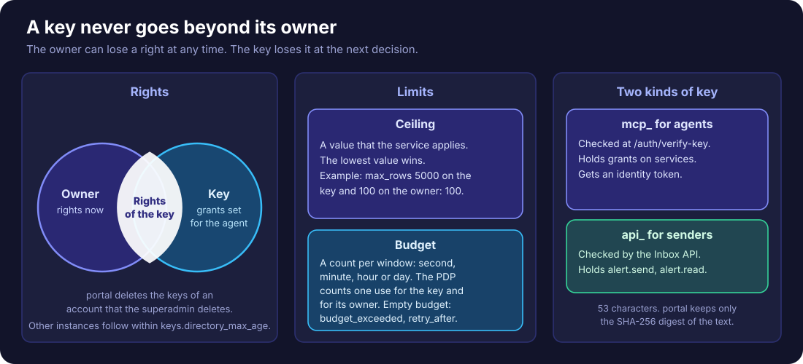

# Keys and limits

A key lets a program call a service for a user. A key never has more rights than its owner. A grant can also hold limits: ceilings that the service applies, and budgets that the PDP counts. This page describes the two kinds of key, the rules, the pages, the edge and the limits.

Without the block `keys`, the keys are off. Each address of the key pages answers `404`.

The picture has three parts. On the left, the rights of a key are the overlap of the rights of the owner and the grants of the key. In the middle, a ceiling takes the lowest value, and a budget counts the uses in a window. On the right, an `mcp_` key is for agents and an `api_` key is for senders.

## The two kinds of key

A key has exactly one kind. The prefix of the key text gives the kind. The kind decides who verifies the key.

| Prefix | Kind | Used by | Verified by | At the other verifier |
|---|---|---|---|---|
| `mcp_` | MCP key | Agents | The key edge, `/auth/verify-key` | Refused: `401`, no detail |
| `api_` | API key | Services, webhooks, callers such as Grafana and Alertmanager | In process, by the API of the Inbox on the portal port | Refused: `401`, no detail |
| `whk_` | Reserved | Nobody | Nobody | Refused as an unknown prefix |

The key text has 53 characters: the prefix of 4 characters, 43 random characters and 6 checksum characters. The random characters are `a-z`, `A-Z` and `0-9`. The checksum is the CRC-32 of zlib (polynomial 0xEDB88320) of the prefix and the 43 characters, written in base62.

The portal shows the text one time, when it makes the key. It keeps only the SHA-256 digest and a hint. The hint is the first 4 of the 43 random characters.

A verifier refuses an unknown prefix, a bad length, a bad character and a bad checksum before any lookup. It then checks the kind. All these refusals are `401` with no detail. A key of another system with another length is refused too.

### Switches

The block `keys` has two switches. `keys.mcp` has the default `true`. `keys.api` has the default `false`. A kind that is off has no key, no right, no chip and no option in the selector. The key edge or the API of the Inbox refuses its keys.

- The kind `mcp` needs the blocks `identity` and `pdp`.
- The kind `api` needs the block `inbox`.
- A block `keys` with both kinds off stops the program at start.
- A block `api_key` needs `keys.api = true`. A block `key` of a block `user` needs `keys.mcp = true`.

## Rules of the keys

- **A key follows its owner.** This holds for both kinds. The rights of a key are the rights that the key holds and the current rights of its owner. When the owner loses a right, the key loses it at once. Other instances follow within `keys.directory_max_age` (default 30 seconds).
- **A key is deleted with its owner.** When the superadmin deletes an account of the database, portal deletes its keys, their grants and their counters. The page of the account tells the number: "Delete carol and 3 keys?". An account of the file cannot be deleted.
- **Creation rights are by kind.** `keys.own.create` and `keys.own.use` apply to the resource type `key_kind`, with the nodes `key_kind:mcp` and `key_kind:api`. An account can have the right to make MCP keys and not API keys. The ceiling `max_key_lifetime` has one value for each kind.
- **The page shows only what the account may make.** With two kinds, the page of a new key has a selector. With one kind, it has no selector. With no kind, the list has no **New key**.
- **A key holds what its kind lists.** An MCP key holds grants on services and the two actions of the questions of the Inbox (`question.ask` and `question.cancel`). An API key holds `alert.send`, `alert.read` and `alert.send_user`, and the two actions of the questions. It holds the grant `access on service:portal` for the budgets `alerts` and `questions`. An API key holds no grant on another service. A key never holds an action `keys.*`.
- **A key never goes beyond its owner.** The account can tick only the rights that the owner holds. A right that the owner lost has a warning mark in the form.
- **A key has an interaction.** The value is `conversational` or `one_shot`. The default is `conversational` for an `mcp_` key and `one_shot` for an `api_` key.
  - A `conversational` key is for an agent that discusses with a person in free text.
  - A `one_shot` key is for a system that decides with no free text. It can ask closed questions only: a `choice` or a `confirm`, with no `allow_custom` and no `allow_ask_back`. Else the answer is `interaction_not_allowed`.
  - The owner sets the value with two radio buttons in the form of the key. The agent cannot set it.
- **A key has a mode of the agents.** The value is `key`, `discover` or `enrolled`. It says what portal does with the agents that share the key. The form of the key has the field only when the file has the block `inbox.agents`. The default is `discover` for an `mcp_` key and `key` for an `api_` key. See [Inbox: agents](inbox/agents.md).
- **A key has a name and an id.** The name has 1 to 64 characters, with no control character. The id of a key of the database has 16 characters of `0-9` and `a-f`. The subject of a key in a question to the PDP is `key:<id>`.
- **Counts are bounded.** A key holds 512 grants at most. A user has `keys.max_per_user` active keys (default 100). The expired keys and the keys that are too old do not count. `keys.default_lifetime` (default 30 days) is the life that the form proposes. The form uses the lower of this value and `max_key_lifetime` of the owner.

## The pages and the edge

- **Key list:** the list of the keys is a panel of the tab Access of the settings pages (`/auth/settings`). A key has a kind icon. Chips filter the list by kind and by owner. A box in each row selects keys for **Revoke**.
- **No list page:** `GET /auth/keys` does not exist.
- **Key form:** the head of the list has **New key**. It opens the page `GET /auth/keys/new`. The page `GET /auth/keys/edit?id=<id>` changes a key. **Cancel** and **Create** (or **Save**) are at the top right.
- **Kind selector:** with two kinds, the page of a new key has a selector that loads the page again with `?kind=`. An API key has the matrix of the Inbox and the budget of the alerts. An MCP key has the services only.
- **Key text:** the page that follows the creation shows the text of the new key one time, with a **Copy** button and **Done**. It has `Cache-Control: no-store`. portal puts the text in no address and in no log. A refused form returns to the form, with the reason in a notice.
- **Edge:** `GET /auth/verify-key` is the ForwardAuth address for the key routes of agents. It reads only memory.
- **Good key:** a good `mcp_` key gives status `204` and an identity token in the header `identity.header`. Traefik accepts each 2xx status.
- **Bad key:** each failure gives status `401`, an empty body and the header `WWW-Authenticate: Bearer`. When the request has the text of a key, the header also has `error="invalid_token"`. The answer never shows the cause. The cause is in the log (`key_check_failed`) and in the metrics.
- **Which service:** the edge finds the service of the path as the gate does (see [Grants and the gate](grants-and-gate.md#which-service-owns-a-path)). The key opens a service only when a grant of the key and a grant of the owner give `access` on it. A path that no service owns opens nothing.
- **Age of the document:** the age of the action document of the service never changes the answer of the edge. `access` stays `true` (protocol 8.3 and 11.1).
- **Senders and agents:** the routes of the Inbox verify the `api_` keys, and the MCP endpoint verifies the `mcp_` keys. See [Inbox](inbox/README.md).

The causes of a refusal in the log are `no_key`, `bad_format`, `wrong_kind`, `unknown_key`, `expired`, `key_too_old`, `owner_unknown`, `owner_cannot_use_keys`, `no_service`, `bad_forwarded_header`, `no_access`, `keys_disabled` and `directory_too_old`.

## Rights, limits and commands

- **Rights of the portal for the keys:** the service `portal` has these actions for the keys: `keys.own.read`, `keys.own.create`, `keys.own.edit`, `keys.own.revoke`, `keys.own.use`, `keys.all.read`, `keys.all.revoke` and `users.read`. The ceiling `max_key_lifetime` of `keys.own.use` limits the age of a key. The Inbox adds its own actions to the same service (see [Inbox](inbox/README.md)).
- **Revoke:** the page revokes keys one at a time or in a group. The command `portal revoke-keys --config FILE (--user LOGIN | --all)` revokes keys without the web page. It makes no key and does not revoke a key of the file. With SQLite, it refuses to run when an instance runs.
- **Accounts of the file:** a block `user "<login>"` defines an account of the file, with optional blocks `key "<name>"`. These blocks are MCP keys of the file. An API key of the file is a block `api_key` of the block `inbox`. A login comes from the file or from the database, never from both. The list of keys in the tab Access lists the MCP keys of the file. It does not list the `api_key` blocks.
- **Counters:** the table `budget_counters` holds the counters. PostgreSQL uses a second pool of connections (`pdp.counter_connections`). `keys.max_counter_rows` limits the number of rows (default 2,000,000).

## Limits

A grant can hold limit values. There are two kinds of limit. The protocol defines them in sections 6 and 7.

- A **ceiling** is a value that the service applies to one use, for example `max_rows`. The PDP gives it in `context.limits`. The lowest value among the grants wins. For a key, the values of the key and of its owner both count, and the lowest wins.
- A **budget** is a count in a window. The window is `second`, `minute`, `hour` or `day`. The value is a list of 1 to 4 items, one for each window. The PDP counts each window on its own counter.
- The PDP counts one use for the key and for its owner. It takes the unit from both counters or from none. When a budget is empty, the PDP answers `false` with the reason `budget_exceeded` and `retry_after`.
- A budget value is on the grant `access` on the whole service. A budget value on another grant is refused.
- A limit that a grant does not give is a limit that portal does not set. The caps of the service still apply.

Rules for the numbers:

- A limit is a whole number from 0 to 9,007,199,254,740,991. This is 2^53 - 1, the largest integer that is safe in JSON.
- An amount of a budget is from 1 to the same value.
- These rules apply to `min` and `max` of a ceiling. They also apply to a value of a ceiling and to an amount.
- portal refuses a larger number in a document, in a form and in a file.
- A grant has 8 limit values at most. Their text has 1024 bytes at most (protocol 6.1).

### Limits of a service

A service declares its limits in the list `limits` of its action document. The settings pages read the declaration to show the text of each limit. A document declares 16 limits at most. An item has these members, and no other member:

| Member | Rule |
|---|---|
| `name` | A name of 1 to 32 characters: `a-z` first, then `a-z`, `0-9` and `_`. A ceiling starts with `max_` and has a noun after it. A budget never starts with `max_`. |
| `label` | The text for the page, up to 60 characters. |
| `description` | A text of up to 300 characters. |
| `unit` | The unit, up to 20 characters. |
| `kind` | `ceiling` or `budget`. |
| `min`, `max` | The range of a ceiling. A ceiling needs both, with `min` not above `max`. A budget has neither. |

An action lists the limits that apply to it in its own list `limits`. The PDP ignores a value for a limit that the action does not list, or that the document does not declare. The metric `portal_limit_values_undeclared` counts the limit values that no document declares.

The service `portal` has its own limits. The ceiling `max_key_lifetime` is on `keys.own.use`. The budget `alerts` is on `alert.send` and `alert.send_user`. The budget `questions` is on `question.ask`. The value of a budget is on the grant `access` of the service `portal`, as for each other service.
