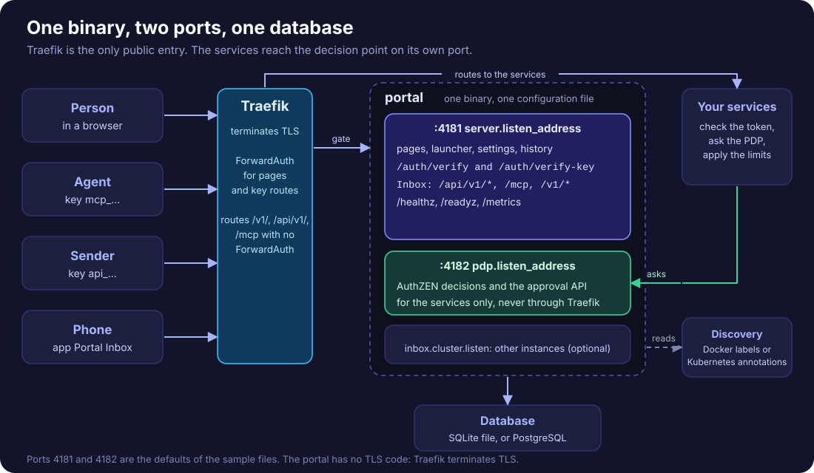

# Overview

portal is one Rust program for a lab or a small organisation. It opens sessions for people and protects the web services behind Traefik. It gives keys to programs and AI agents, answers AuthZEN questions, and sends alerts to Android phones. It is the backend, the edge and the decision point of [ProcurAuth](https://procurauth.github.io/procurauth/).

## What portal does

portal has one binary, one configuration file and one database. It does these functions:

| Function | What it does | Page |
|---|---|---|
| **Launcher** | It lists the services of a lab. A service declares itself by label (Docker Compose) or by annotation (Kubernetes IngressRoute). | [Launcher](launcher.md) |
| **Gate** | It is a Traefik `ForwardAuth` server. It protects each service with the session of a person. | [Grants and the gate](grants-and-gate.md) |
| **Accounts** | One superadmin comes from the configuration. The superadmin makes users. A user gets permissions from the settings pages or from the configuration. | [Authentication and sessions](authentication.md) |
| **Keys** | A user makes keys. A key lets a program act for its owner, with limits. A key has one of two kinds: `mcp_` or `api_`. | [Keys and limits](keys-and-limits.md) |
| **Decision point** | portal gives an identity token to the services. It is also an AuthZEN PDP for them. | [Identity tokens and the PDP](identity-and-pdp.md) |
| **History** | portal keeps a record of each session and of the services that it opened. | [Settings pages and history](settings-and-history.md) |
| **Inbox** | The Inbox sends alerts to Android phones. It makes sure that each phone shows each alert one time. It also carries the questions and the approvals of AI agents. The Android app has the name Portal Inbox. | [Inbox](inbox/README.md) |

Each part except the launcher, the gate and the accounts is optional. A file with no block `keys` and no block `inbox` runs the portal as a panel of services only. See [Settings pages and history](settings-and-history.md) for the switches.

## The idea behind portal

A person opens a session once. Traefik asks portal about each request to a protected service. portal answers from memory, so the check is fast. A program that acts for a person gets a key. A key never has more rights than the person who owns it. When the person loses a right, the key loses it at the next decision.

A service does not know the users or the keys. It receives a short identity token from the edge. It asks the decision point one AuthZEN question, and it applies the answer. The answer can hold limits, such as a number of rows or a budget of requests for each minute. The ProcurAuth protocol defines these rules. portal is one implementation of them.

The Inbox is a feature of the portal. A sender posts an alert with an `api_` key. A sender is a script, Grafana or Alertmanager, for example. portal stores the alert and sends it to each phone that follows the group. An AI agent can ask the owner of its key to approve an action. The owner answers on the phone or on a web page.

## How it is built

- The runtime image is `FROM scratch`. It holds one static binary. The HTTP stack is Hyper 1.x on Tokio.
- Pages are rendered in Rust. The scripts are the theme selector, the script of the settings pages and the script of the notifications. There is no JavaScript framework, no CDN and no runtime shell. Nothing is fetched from the internet at run time.
- The data lives in one database. By default it is one SQLite file. The SQLite library is bundled in the binary. To run several active instances, use a shared PostgreSQL database. There is no Redis. See [Several instances](several-instances.md).
- The project code has no `unsafe` Rust.
- The configuration is one strict HCL file. See [Configuration](configuration.md).

## Where to go next

| You want to | Read |
|---|---|
| Run portal on your machine | [Getting started](getting-started.md) |
| Understand the ports and the flows | [Architecture](architecture.md) |
| Put portal behind Traefik | [Traefik and TLS](traefik.md) |
| Set every option | [Configuration](configuration.md) |
| Run it in production | [Operations](operations.md) and [Security model and hardening](security.md) |
| Send alerts to a phone | [Inbox](inbox/README.md) |
| Know the limits | [Limitations](limitations.md) |
