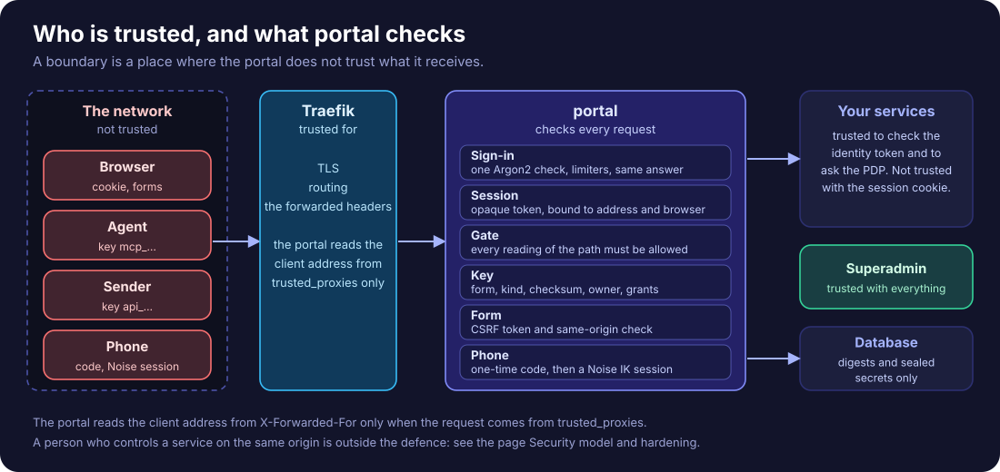

# Security model and hardening

This page states what the portal protects, who it trusts and which rules the code keeps. It also lists the known limits of a deployment and the measures that remove them. To report a vulnerability, read the [security policy](../SECURITY.md).

## Model

The portal is a ForwardAuth gate, the launcher of a lab, an AuthZEN decision point (PDP) and the Inbox. It has one superadmin, defined by the configuration, and users with grants. It does not implement groups, OAuth, OpenID Connect or password reset.

- **One identity.** An account has one login and one set of permissions for the launcher, the keys and the Inbox. The permissions for the keys and the Inbox are on one internal scope, the service `portal`.
- **Passwords.** The database keeps only Argon2id hashes. Each sign-in costs one Argon2 check, also for an unknown login. The failure message is always the same.
- **Sessions.** A session is an opaque random token. The server keeps only its SHA-256 digest. The session is bound to the client address and the browser.
- **Gate.** A new user has no permission. The gate checks the forwarded path in every way that a proxy can interpret it. It lets a request pass only if every interpretation is allowed.
- **Keys.** A key never gets more than its owner. The portal keeps only the digest of the key text. A verifier checks the form and the kind of a key before any lookup.
- **Inbox.** A phone enrolls with a one-time code of an account. The session is Noise IK to a key that the phone pinned. A sender proves itself with an `api_` key. The permissions of the portal features decide who sends, reads and revokes.
- **Configuration.** The file is the only source. A secret comes only from `_env` or `_file`. An unknown key stops the program at start.
- **Logs.** The log never holds a password, a key text or a secret. The effective configuration shows `<hidden>` for each secret.
- **Code.** The `portal` binary and the crate `inbox-core` have no `unsafe` Rust. The binary has `#![forbid(unsafe_code)]`. Only the JNI bridge of the Android app (`crates/inbox-android`) uses `unsafe`. The Linux release binary is static.

### Who is trusted

- **The superadmin** is trusted with everything. The superadmin sees every page, manages every account and opens every service.
- **The proxy** (Traefik) is trusted to terminate TLS, to route as the documents say and to set the forwarded headers. The portal reads them only from the networks in `server.trusted_proxies`.
- **The person who can create a container or an IngressRoute** chooses what the launcher lists and which actions the settings pages offer for a service. This is the trust boundary of the discovery. It is acceptable for one administrator.
- **A service** is trusted to check the identity token and to ask the PDP. It is not trusted with the session cookie (see [the known limits](#known-limits-and-deployment-measures)).
- **A user** is trusted with the grants of the account only. A key is trusted with less: never more than its owner.

### What the portal defends

- Access to a service without a grant, and access with a forged or replayed session.
- An attacker who guesses a password, a second-factor code or a key. The limiters, the lock of the second step and the checksum of the key text defend against it.
- The discovery of which logins exist.
- A request that a proxy and a backend read in different ways (path confusion).
- A leak of the database. The database holds no password, no session token and no key text, only digests and sealed secrets.
- A key that gets more rights than its owner.
- The cross-site use of a form (CSRF) and a form post from a foreign origin.

### What the portal does not defend

- A service, or a person who controls a service, on the same origin. This person receives the session cookie unless the proxy removes it.
- A browser, a phone or a host that an attacker controls.
- A false page that asks for a password or a TOTP code. Only a passkey stops this, and this version has no passkey.
- Plain HTTP on an untrusted network. Only HTTPS removes the exposure.
- A superadmin who acts against the lab. The superadmin is trusted.
- A service behind the gate that has its own flaws. The portal checks the right to open the service, not what the service does.

## Core invariants

These rules are the security contract of the code. A change that breaks one of them is a defect.

### Process and configuration

- The project code of the binary contains no `unsafe` Rust.
- Hyper parses HTTP/1.
- The server limits the request headers, the connection count, the body size and the read times.
- The start fails when the HCL configuration is unknown or invalid.
- A secret of the configuration (password, key text, token) uses only `_env` or `_file`. A secret in clear text stops the start.
- The server refuses at start the example superadmin passwords and the example session secret that the repository publishes. The error names the key and never shows the value.
- Security failures fail closed.

### Passwords and sign-in

- The server reads the superadmin password from an environment variable or from a file, with a size limit. It hashes the password once with Argon2id and then erases it from memory.
- The server stores user passwords only as Argon2id hashes. Each sign-in attempt costs exactly one Argon2 check, for every login name. A dummy hash replaces an unknown login name. A failed sign-in returns the same message.
- A new password is hashed under the same Argon2 permit as a sign-in. It ends the sessions of that account.
- The server limits the Argon2 concurrency, and it limits the rate of failed sign-ins for each address and globally. The global limiter has a separate budget for the superadmin login.
- The server reads at most `server.max_login_body_reads` sign-in bodies at the same time, so slow bodies cannot hold every connection that ForwardAuth needs.
- Each sign-in proof and each session carries a stamp of the credential that the proof checked. A proof opens a session, and a session acts, only while the account has the same stamp. A password step or a second step that started before a new password opens no session.
- A form checks the session again after its body. A session that ended while the body arrived does not act. `Log in as` and `Back to superadmin` give no session in place of a session that ended.
- The superadmin login has one owner. An account of the database or a block `user` with this login stops the start.
- A new superadmin login, password or session secret ends the sessions of the superadmin and the impersonated sessions. This also applies with PostgreSQL, where the other sessions survive a restart.
- `Log in as` and `Back to superadmin` keep the end of the session that the password opened. A switch never gives a fresh `session.ttl`.

[Authentication and sessions](authentication.md) describes the sessions, the second factor and the limiters.

### Sessions and cookies

- A successful sign-in creates a random, opaque session identifier of 256 bits. The server holds only a SHA-256 digest of it. With PostgreSQL, the digest is in the shared database, and the database never stores the cookie.
- A logout revokes the exact session on the server. With SQLite, a restart ends all sessions. With PostgreSQL, the sessions survive a restart.
- A logout, a deleted account or a changed password ends the session in the database at once. The other instances end their copy within 5 seconds.
- Over HTTPS, the cookies are host-only (`__Host-`), `Secure`, `HttpOnly` and `Path=/`. Their SameSite value is `Strict` or `Lax`. Over plain HTTP, the cookies use the same names without the prefix and have no `Secure` attribute.
- A session works only from the client address and User-Agent that opened it (`session.bind`), and it ends after `session.idle_timeout` without use and after `session.ttl`.
- The box "Remember me" is the only way to a persistent cookie. A remembered session follows the same rules for a logout, a deleted account, a new password and **End all sessions**. `Log in as` never opens a remembered session.
- The page after a refused sign-in has the same form for every cause of the refusal, and it never shows the box ticked.

### Gate and catalogue

- A new user has no grant and opens no service. Access comes from a grant only. The superadmin has all grants.
- A path that no service owns is open to each signed-in user only when the catalogue is complete. Until each configured discovery source has answered once, only the superadmin passes the gate.
- A workload with unusable labels keeps the path of its `href` closed. A workload that does not ask to be listed, or whose id another workload uses with another `href`, keeps it closed too. Only the superadmin passes a closed path.
- The gate decodes an `href` in the same way as a request path. A segment that starts with the last segment of a prefix belongs to that service, as the Traefik `PathPrefix` rule routes it. Such a path gets no identity token.
- The gate reads the forwarded path in every way that a proxy or a backend can read it. It allows the request only if every way allows it. It refuses a URI that it cannot read.
- The portal receives only the headers of a request (ForwardAuth). It never receives the body of a service.
- The launcher lists only the services for which the user has `access`. The 403 page names no service.
- Discovery problems name workloads. Only the superadmin sees them.
- The settings pages give a grant below a service only for a level that the service declares and an action that lists its type. Each resource id is exact: the server does not trim it or change its case. An id with a control character or of more than 256 bytes is refused.
- The text form of a grant writes each id with one canonical percent code. A `/` or a `:` in an id thus never divides a segment. The parser refuses another code for the same id.
- In the mode `static`, the settings pages refuse a change of grants. In the mode `hybrid`, they cannot change a grant of the configuration.

[Grants and the gate](grants-and-gate.md) describes the rules. The PDP has its own invariants in [Identity tokens and the PDP](identity-and-pdp.md).

### Accounts and forms

- Only the superadmin can administer accounts: add, edit, delete and `Log in as`. The server checks this rule.
- A form of the account administration uses a purpose-bound anti-CSRF token and a same-origin check.
- The **Generate** button of the add-user form draws a 20-character password in the browser. It uses `crypto.getRandomValues` and an alphabet without look-alike characters. The password reaches the server only when the superadmin submits the form.
- The server writes every change of accounts to the audit history.
- The history records addresses and user agents, and it keeps them for `storage.retention_days`. It never records a path, a query, a password or what a person typed in a login that does not exist.

### Pages, headers and metrics

- The server renders the launcher. The launcher references nothing outside the binary. Its Content-Security-Policy is `default-src 'none'` with `style-src`, `script-src`, `img-src` (with `data:`) and `connect-src` set to `'self'`, and `form-action 'self'`, `frame-ancestors 'none'`, `base-uri 'none'` and `object-src 'none'`.
- The server HTML-escapes every value taken from a label. Every `href` is a local path or an http(s) URL.
- Icons are SVG files in the image, indexed once at start. A request names only an indexed icon and cannot build a path. The server serves each icon with `Content-Security-Policy: default-src 'none'; style-src 'unsafe-inline'; sandbox`.
- A return path holds a local path and query only, and the server signs it with an HMAC. A return path with an ASCII control byte (0x00 to 0x1F, 0x7F) is refused, raw or after one percent decode. A URL parser of the URL Standard removes TAB, CR and LF, so `/<TAB>/host` would become `//host`.
- The server builds dynamic header values (`Location`, `Set-Cookie`, `Retry-After`) with typed Hyper header values. An invalid value is not sent.
- Prometheus labels never hold an unbounded value, a secret or a value that a user controls.

### Identity token, PDP, keys and Inbox

- The identity token holds no permission. It has a short life (`identity.token_ttl`, 5 minutes by default, 1 hour at most), and a service must check its signature, `iss`, `aud` and `exp`.
- A key has one of two kinds. The prefix gives the kind: `mcp_` for agents and `api_` for services and webhooks. The prefix `whk_` is reserved. Each verifier refuses the other kind with `401` and no detail.
- The portal never stores the text of a key. It stores the SHA-256 digest and a hint of the first 4 random characters. A wrong character or a changed prefix gets no database read.
- The key edge `/auth/verify-key` reads only memory. A refusal gives status 401 with an empty body, and the body and the headers never tell which check failed. The log has at most one line each minute for each address and cause.
- A key never gives more than its owner. The PDP checks both sides at each question, and the lowest ceiling applies. When the owner loses a right, the key loses it at once. When an account is deleted, its keys go with it.
- The PDP fails closed. It answers `false` for an unknown user, an unknown subject type or a bad action name. It also answers `false` for a node that does not follow the last known document of the service. It never decides for a resource of another service.
- Each service has its own bearer token for the PDP. The PDP keeps only the SHA-256 of each token, compares tokens in constant time and returns `401` without a valid token.
- The portal counts the uses of a budget in the database. A failed count gives status 503, never `true`.
- The Inbox invariants are on [Inbox: security model](inbox/SECURITY.md).

## Request-origin checks

Before the server parses the body of a `POST` to `/auth/login`, `/auth/logout` or an account route, it verifies the request origin. This check is defense in depth. It works in addition to the anti-CSRF token.

- With the forwarded metadata of Traefik, the server requires one unique `X-Forwarded-Proto` header and one unique `X-Forwarded-Host` header.
- Without forwarded metadata, the expected origin is `http` plus the unique `Host` header.
- If `Origin` exists, it must match the expected origin exactly. A mismatch cannot use `Referer` instead.
- If `Origin` is absent, the server requires one unique absolute `Referer` with the same origin.
- The server rejects `Origin: null`, duplicate headers, unsupported schemes, userinfo and partial forwarded metadata.

Each form that changes state needs both an anti-CSRF token and the origin check. These are `POST /auth/login`, `POST /auth/logout`, and the account routes `POST /auth/users/add`, `/update`, `/delete`, `/impersonate`, `/impersonate-end` and `/end-sessions`. The other settings forms follow the same rule.

For the sign-in, the token is a double-submit cookie that lives 12 hours. When the cookie is gone, the portal shows the sign-in page again. The page has a new token and the sentence "The page was open too long" (status 403). For the other routes, the token is an HMAC of the purpose (`logout` or `users`) and the session ID. The form of the button carries it, so no cookie can expire under a page that stays open. A token for one action cannot serve another action.

The account routes also check on the server that the session belongs to the superadmin and is not an impersonated one. In K3s, these paths do not pass through ForwardAuth, so the portal cannot rely on the gate. The `Sign out` button sends a POST. `GET /auth/logout` only redirects to `/`. Authentication pages send `Referrer-Policy: same-origin`.

## HTTP resource limits

The server configuration sets these limits (the defaults are in the [configuration reference](configuration.md)): `server.max_connections`, `server.max_headers`, `server.max_header_bytes`, `server.header_read_timeout`, `server.max_body_bytes` and `server.body_read_timeout`.

The Hyper HTTP/1 parser receives the header limits and the timeouts. The application collects the body in parts and checks the size before each extension. A total read timeout wraps the collection. `POST /auth/login` is the only route that reads a body before it knows the client. The API of the Inbox checks the key of the sender before it reads the body. One connection can hold a slot for `header_read_timeout` plus `body_read_timeout`.

The server therefore reads at most `server.max_login_body_reads` sign-in bodies at the same time. A sign-in keeps its place until it gets the Argon2 permit. It waits for this permit only until `body_read_timeout` ends. The server refuses the other sign-ins at once with `503` and `Retry-After: 1`. This value must be less than `server.max_connections`, so ForwardAuth always has connections left.

The client address comes from `X-Forwarded-For` only when the TCP peer is in `server.trusted_proxies`. Keep the networks of this list small. In K3s, the NetworkPolicy `allow-portal-http` admits only the Traefik and Prometheus pods to the port 4181.

## Plain HTTP

The portal knows nothing about TLS. Traefik terminates TLS, and the portal listeners speak plain HTTP. Traefik can also serve plain HTTP, for example on a LAN without certificates and in a test stack. The server reads the scheme of each request from the unique `X-Forwarded-Proto` value that Traefik sets (`trustForwardHeader: false`). Any value other than a single `https` counts as HTTP.

Browsers refuse `Secure` and `__Host-` cookies over HTTP. Therefore, over HTTP, the cookies have no prefix (`portal`, `lc`) and no `Secure` attribute. Over HTTP, an attacker on the network can read the password and the session cookie. The binding limits the value of a stolen cookie, and so does the idle timeout. Only HTTPS removes the exposure. Use HTTPS on every network that you do not trust.

## Discovery and the launcher

The catalogue comes from two sources. The first is the container labels, which the server reads from the Docker socket (mount it read-only). The second is the IngressRoute annotations, which the server reads from the API of the cluster. The ServiceAccount is limited to `get` and `list` on `ingressroutes` and `pods`.

A workload with unusable labels is skipped and the page reports it. The workload is not listed in part. The gate keeps the path of its `href` closed, because Traefik still routes the workload.

The gate opens a path that no service owns to each signed-in user. This rule is safe only when the catalogue holds every service. The first snapshot after a start is empty. Until each configured source has answered once, the gate lets only the superadmin through. A source that failed at setup keeps this state for the life of the process. The metric `portal_catalog_complete` shows the state.

A source that answers can still miss a workload that Traefik routes, for example a container that restarts or that Compose recreates. The path of such a workload keeps its last owner, or stays closed, for 20 refreshes after the last list that names it. A new workload has no owner until the first refresh that lists it. In this time, each signed-in user passes the gate for its path, without an identity token. A service that checks the identity token refuses such a request.

Health probes are plain GET requests to URLs from labels. They do not follow redirects, do not read the body, have a timeout and a concurrency limit, and send nothing secret. The probe client does not verify certificates: it asks only whether something answers. The reads of the action documents and of the options use another client. It verifies the certificate and the host name of an https URL with the embedded Mozilla roots. A read that fails this check gives no document and no option.

The server reads the action document of a service from an internal URL that a label gives (`portal.actions`, or the origin of `portal.health`). The read has a timeout, a size limit (`access.max_document_bytes`, 256 KiB by default) and no redirect. The concurrency is limited. The server refuses the whole document in four cases. The document has a bad action, a duplicate action or the action `access`. Or its `server` is not the id of the service.

## Second factor (TOTP)

[Authentication and sessions](authentication.md#second-factor-totp) describes the second factor. This section gives its security properties.

### What it stops

- A password that a thief knows or guesses. A thief needs the code of the app too.
- A password that leaked from another site and that the person reused. The attacker reaches the second step and no further.
- A copy of the database. The secrets are sealed with AES-256-GCM under `authentication.totp_key`, and the associated data names the login. A reader of the database cannot read a secret and cannot move it to another account. The recovery codes are keyed HMAC-SHA-256 values, so a reader without the key cannot test a guess.

### What it does not stop

- A false page. A person can type a TOTP code in it, and the attacker uses it at once. Only a passkey (WebAuthn) is bound to the real site.
- A thief who has the password, the key and the database. This person can read the secrets.
- A stolen session cookie. The cookie is a session that has passed the second factor already. The binding `session.bind` and the idle time limit this risk.
- The loss of the phone and of the recovery codes. The superadmin resets the account. For the superadmin account, use `portal reset-two-factor`, which needs access to the host and the configuration.

HMAC-SHA-1 is safe for TOTP: the attacks on SHA-1 are collision attacks, and an HMAC does not depend on collision resistance. The portal uses HMAC-SHA-1 for TOTP only.

### Design

- **State between the two steps.** The password step gives no session. It gives a token that the server signs (HMAC-SHA-256 under the session secret). The token holds the account, the choice "Remember me", the count of wrong codes and the time of issue.
- **Proof in the token.** The token also holds a keyed digest of the credential that the password step checked and of the second factor at that time. The second step continues only while both are the same. The token is bound to the client binding and to the anti-CSRF token of the page, and it lives 5 minutes.
- **Refusal of a token.** A changed token, an old token or a token from another client gives the page "The page was open too long". A person cannot tell these causes apart.
- **Anti-enumeration.** The first step does not change. A wrong password gives the same answer for an unknown login, for an account with a second factor and for an account without. Only a person who knows the password reaches the second step. This person learns that the account has one. This is accepted.
- **Brute force.** The counters of an account are in its database row: failures, start of the window and end of the lock. Each attempt counts in one write transaction before the comparison of the code. Attempts at the same time, on one or on several instances, therefore compare at most five codes before the lock. A good code clears the count.

Five failures in 10 minutes lock the second step for 5 minutes. A TOTP code has 10^6 values and three are valid at a time. The lock thus keeps the chance of a guess below 1 in 10^5 for each 5 minutes. An attacker who has the password can lock the second step for the person. An anonymous attacker cannot.
- **Replay.** The row keeps the last accepted time step. A statement accepts a step only if it is more than the stored step, so two instances never accept the same code. The code that confirms an enrolment is spent.
- **Recovery codes.** Ten codes of 50 bits, shown one time and stored as keyed hashes. The delete of the hash is the use, and it succeeds for one caller only.
- **Wrong key.** At start, the server compares a check value of the key with the value in the database. A key that does not match stops the server. A secret that a key does not open gives an error of the server, never a wrong code. The server never replaces a secret under another key.
- **Pages.** The pages of the second step go through the pass of the random names, have no inline script and no inline style, and send `Cache-Control: no-store`. The QR code is inline SVG markup, so the page makes no image request.

## Password controls

Two limiters protect against password failures: a per-IP limiter and a separate global limiter. A successful sign-in does not reset the global limiter, on purpose. Both stores are local to the process. The global limiter has one budget for the superadmin login and one for all other logins. Anonymous failures thus cannot refuse the sign-in of the superadmin.

This has a cost. While one budget is locked out, the answer tells whether a typed login is the superadmin login. The login is not a secret, because each identity token carries it in `sub`.

Argon2 checks run through an async semaphore and `spawn_blocking`. This keeps the heavy hash work away from the Tokio I/O workers.

## Metrics and logs

The security-relevant metrics cover these items:

- sign-ins, CSRF failures and origin failures;
- IP and global rate-limit blocks;
- ForwardAuth results (with `denied`) and session checks;
- active sessions and their capacity;
- Argon2 checks and account administration;
- dropped history events and connection saturation.

No metric label holds a login, an address or a user agent. The list of metrics is in [Operations](operations.md).

The log records events such as `login_success`, `login_failed`, `login_rate_limited`, `origin_check_failed` and `session_capacity_reached`. The log never holds a password, a session ID, an anti-CSRF token, an HMAC secret, a Cookie header, a return signature or an Authorization header.

## Dependency resolution

The file `Cargo.lock` is generated on purpose with `scripts/update-lockfile.sh` after a dependency change. Review it and commit it. CI, Docker and release builds use the committed resolution with `--locked` or `--frozen`. A release job never regenerates it. [Build and release](build-and-release.md) describes the build.

## Known limits and deployment measures

These limits come from the deployment, not from the code. The portal cannot remove them. Apply the measures below.

### The session cookie goes to every service on the same origin

The session cookie has `Path=/`. The browser sends it with each request to the origin of the portal. In K3s, the services are routed by path on the same origin (`/grafana/`, `/dagu/` and others), and Traefik forwards the `Cookie` header to the service. A service, or a person who controls a service, therefore receives the session cookie, the client address and the User-Agent. With these three values, the service can act as the user, also as the superadmin.

Measures:

- Remove the portal cookie from the requests to the services. Use a Traefik middleware that removes the `Cookie` header, or only the portal cookie, on the routes of the services.
- Better, give the portal its own host name, and give each service that you do not trust its own host name. A host-only `__Host-` cookie then never reaches these services.
- Use the identity token (`X-Identity-Token`) in the services, not the cookie.
- Keep `session.bind = "ip_user_agent"` and a short `session.idle_timeout`.
- Keep `session.remember_ttl` as short as the site accepts, or set `session.remember = false`. A persistent cookie stays valid on a device that other persons can use. A stolen cookie of a remembered session works for up to 30 days (the default). It stops when the owner ends the session or when the superadmin ends all sessions.

### The settings pages share the origin of the services

The settings pages and the account administration (`/auth/settings`, `/auth/users/*`) are on the same origin as the services. The `Origin` check and the anti-CSRF token do not separate the portal from a script that a service serves on the same origin. Such a script can read the settings pages and send the administration forms of the superadmin.

Measures:

- Serve the portal (`/auth/*`) on a host name of its own, and do not route services on that host name.
- Do not route on the portal origin a service that lets its users publish HTML or JavaScript.
- Open the settings pages only in a browser profile that does not open the services.

### Forwarded headers of ForwardAuth

`/auth/verify` and `/auth/verify-key` know the request only from `X-Forwarded-Uri` and `X-Forwarded-Method`. With `trustForwardHeader: false`, Traefik writes these headers from the request that it routes. With `true`, Traefik copies the values that come from a trusted hop (`forwardedHeaders.trustedIPs`). A hop that passes the headers of the client lets the client send `X-Forwarded-Uri: /auth/login`. The request then reaches a service without a session.

Use `true` only when each hop in front of Traefik overwrites or removes four headers of the client. These are `X-Forwarded-Uri`, `X-Forwarded-Method`, `X-Forwarded-Host` and `X-Forwarded-Proto`. The key `forwardedHeaders.trustedIPs` alone does not remove them. [Traefik and TLS](traefik.md) gives the full measures.

### Traefik path normalisation

The gate reads the path of `X-Forwarded-Uri` in each way that a proxy or a backend can read it, after it removes dot segments. Traefik must route on the same clean path. Assume that Traefik routes on a path that still holds `..` or an encoded `/` (`%2F`). A request can then match the route of a service, while the gate reads it as a path without an owner.

Measures:

- On each entry point of Traefik, set `http.sanitizePath: true`. Set each key of `http.encodedCharacters` to `false`: `allowEncodedSlash`, `allowEncodedBackSlash`, `allowEncodedNullCharacter`, `allowEncodedSemicolon`, `allowEncodedPercent`, `allowEncodedQuestionMark` and `allowEncodedHash`. The file [`examples/traefik-entrypoint-snippet.yaml`](../examples/traefik-entrypoint-snippet.yaml) shows an entry point.
- Check the effective configuration of the entry point after each upgrade of Traefik.
- The gate gives a segment that starts with the last segment of a prefix to that service, as ``PathPrefix(`/files`)`` routes it. A router rule must not match a path outside the text prefix of the `href` of its service. For example, a deep link `/pgadmin/browser/` with the rule ``PathPrefix(`/pgadmin`)`` leaves `/pgadmin/misc/` without an owner.

### Other limits

- The PDP listener has no TLS. This differs from AuthZEN, which requires TLS. Limit the network of the listener to the services. In K3s, the NetworkPolicy `allow-portal-pdp` admits to the port 4182 only the pods with the label `portal-pdp-client: "true"`. See [`deploy/k3s/network-policy.yaml`](../deploy/k3s/network-policy.yaml).
- The identity token stays valid until `exp` after a logout. Keep `identity.token_ttl` short.
- The failed-sign-in limiters are local to each instance. With N instances, an attacker has up to N times the budget.
- The Android app accepts clear text traffic for each address, and it has no network security configuration. The Inbox page lists the other limits of the phones.
- The portal does not ask for a fresh sign-in or a fresh second factor before a sensitive action. Examples are to create a key, to use `Log in as` and to change a password.
