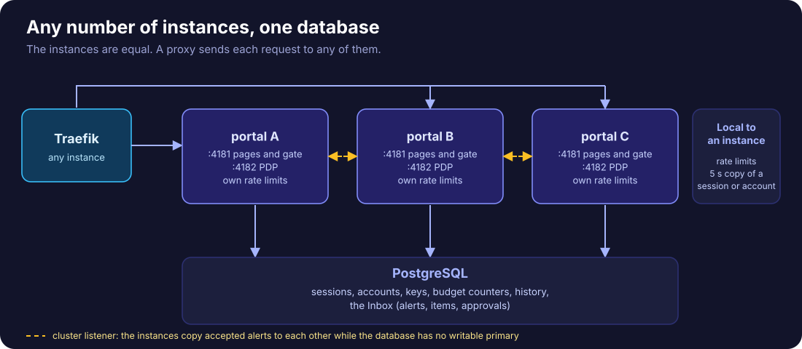

# Several instances (PostgreSQL)

By default, one process owns a SQLite file, and only one instance can be active. The optional `postgres` block moves all data to a shared PostgreSQL database. Then any number of instances can run at once. This page tells what the instances share, what stays local to each instance, and how to move from SQLite to PostgreSQL.



## Configure the shared database

If one instance stops, the only cost is the requests that it served.

```hcl
session {
  secret_mode = "provided"                   # required: every instance signs with the same key
  secret_file = "/run/secrets/portal_session_secret"
}

storage {
  retention_days = 90                        # storage.database must be absent with the postgres block
}

postgres {
  host            = "postgres.example.org"
  port            = 5432                     # default
  database        = "portal"
  user            = "portal"
  password_file   = "/run/secrets/portal_db_password"   # or: password_env = "PORTAL_DB_PASSWORD"
  pool_size       = 8                        # default 4, 1 to 64
  connect_timeout = "5s"                     # default, 1s to 60s
}
```

- The key `session.secret_mode` must be `"provided"` when the `postgres` block is present. Every instance then signs with the same key.
- The key `storage.database` must be absent when the `postgres` block is present.
- The `postgres` block has no TLS keys. The client is a synchronous PostgreSQL client. It uses plain TCP, with no TLS stack and no C dependency. Keep the connection inside a private network.
- The PostgreSQL server must accept `scram-sha-256` over a connection without TLS from the instances.
- At start, the first connection is retried for about one minute. Then the schema is created or updated under an advisory lock. Several instances that start together are therefore safe.
- A statement that runs for more than 15 seconds is cancelled. A broken connection is replaced, and the operation is retried once. This is what a failover of the database looks like.
- The counters of the budgets of the keys use their own connections. The key `pdp.counter_connections` sets their number (default 2). See [Keys and limits](keys-and-limits.md).

## What the instances share

- **Sessions** are rows of a `sessions` table.
  - A row holds the digest of the cookie, the client binding, the identity, the expiry and the last use.
  - A sign-in writes the session and its line of the history in one transaction.
  - Each instance keeps a copy of what it checked. The copy lives for **5 seconds**. ForwardAuth asks the database about one session once every 5 seconds, not once for each request.
  - The binding (address and User-Agent), the idle timeout and the absolute lifetime apply exactly as with SQLite. The idle timeout is renewed at most every 5 seconds of activity.
  - A sign-out, a deleted account or a password change ends the session in the database at once. The session then stops on the other instances within 5 seconds (the copy).
  - If the database cannot be reached, a session that was checked less than 2 minutes ago is still accepted. A failover therefore does not sign everybody out. New sign-ins fail with `503` in the meantime.
- **Superadmin sessions** also carry the credential generation of the superadmin.
  - This value is an HMAC-SHA-256, under the session secret, of the superadmin login and password. The database never holds a plain hash of the password.
  - An instance accepts a superadmin session or an impersonated session only with its own generation. At start, an instance deletes these sessions when they have another generation.
  - Thus a new superadmin login, password or session secret ends the old superadmin sessions on every instance. Rotate the credential after a suspected theft of a superadmin cookie.
  - When you update the instances one by one, an old instance and a new instance refuse the superadmin sessions of each other. The sessions of the users stay.
- **Sessions of the accounts** carry the stamp of the credential that opened them.
  - The stamp is a SHA-256 digest of the source of the account, its login and its password hash.
  - An instance accepts a session only while the account has the same stamp. Thus a new or removed `password_hash` of an account of the file ends its sessions on every instance.
  - A new account with the same login does not get the sessions of an old account.
- **Accounts** are read from the database every 5 seconds by every instance.
  - An account that is created, edited or deleted on one instance reaches the others within 5 seconds.
  - A sign-in attempt makes the instance read the accounts again at once, at most once every second. An account that was just created can therefore open a session on any instance.
  - A request with a session of an account that the instance does not know also makes it read the accounts again, with no minimum gap. A session that was opened for this account elsewhere is never ended for that reason.
- **Keys and external services** are rows of the shared database. Each instance reads them with the accounts.
- **The second factor** of an account is in the shared database. An instance reads it when an account opens a session with a code.
- **History** is written by every instance.
  - The writes are batched every 15 seconds, as with SQLite.
  - A session that ends by sign-out, revocation, expiry or idleness is recorded once. The instance whose call ended the session records it. The database gives each ended session to exactly one caller.
  - The start or the stop of an instance never closes the sessions of the other instances.
- **The Inbox** keeps its data in the same database. The instances copy accepted alerts to each other through the cluster listener while the database has no writable primary. See [Inbox](inbox/README.md).

## What stays local to each instance

- Each instance has its own rate limits. The failed-sign-in limiters (for each address and global) are in memory. With two instances, an attacker has up to twice the budget. A lockout on one instance does not lock the other instance.
- The counters of the wrong second-factor codes of an account are in the database, so every instance adds to them.
- `session.max_active_sessions` and `session.max_sessions_per_account` are checked against the database. Two instances that race at a limit can each overshoot it by one.
- The instance that adds an account checks `users.max_users` against its own copy. Two instances that add accounts at the same moment can exceed the limit by one.

## Health and metrics

Liveness and readiness are unchanged. `/healthz` does not touch the database. `/metrics` adds two series:

- `portal_shared_store_errors_total{use="sessions|directory"}` counts the calls to the shared database that failed.
- `portal_directory_age_seconds` is the time since the database last answered a read of the accounts. It grows when the refresh fails.

## Move from SQLite to PostgreSQL

The command `portal import-sqlite --config FILE --from SQLITE_FILE` copies the data to PostgreSQL.

- The configuration names the PostgreSQL database. The database must be empty. The command refuses a target that already holds any of the copied items, and it then changes nothing.
- It copies these items:
  - the accounts with their grants, and the keys with their grants;
  - the revoked keys of the key history, and the external services;
  - the second factors (secrets and recovery codes);
  - the sessions of the history, the service accesses, the audit events and the sign-in log.
- The copy is one transaction. The command prints how many items of each kind it copied.
- The command only reads the SQLite file. The SQLite file can be the live file.
- Sessions do not move. They were in the memory of the old process. The sessions that the file still shows as open end where they were last seen, with the reason `restart`. Every user must open a new session after the switch.
- Changes made to the SQLite file after the import are not copied. Do not change accounts between the import and the switch.
- The rows of the counters of the budgets are not copied. Each instance makes the rows that its grants need at its start.
- The data of the Inbox has its own command, `portal inbox import-sqlite`. See [Inbox](inbox/README.md).
